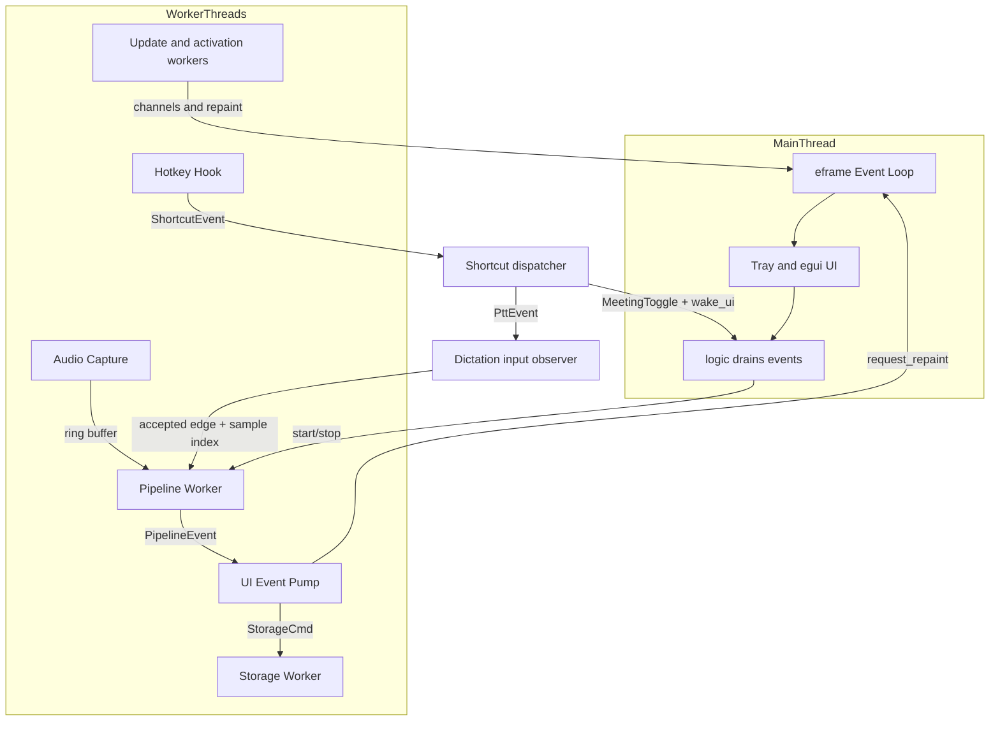
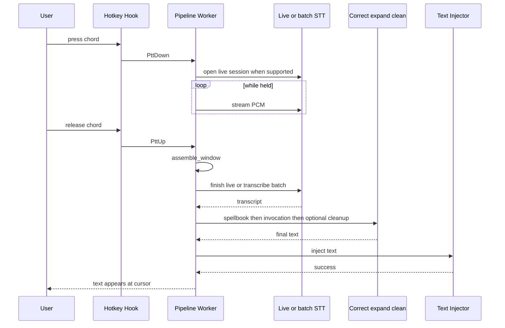
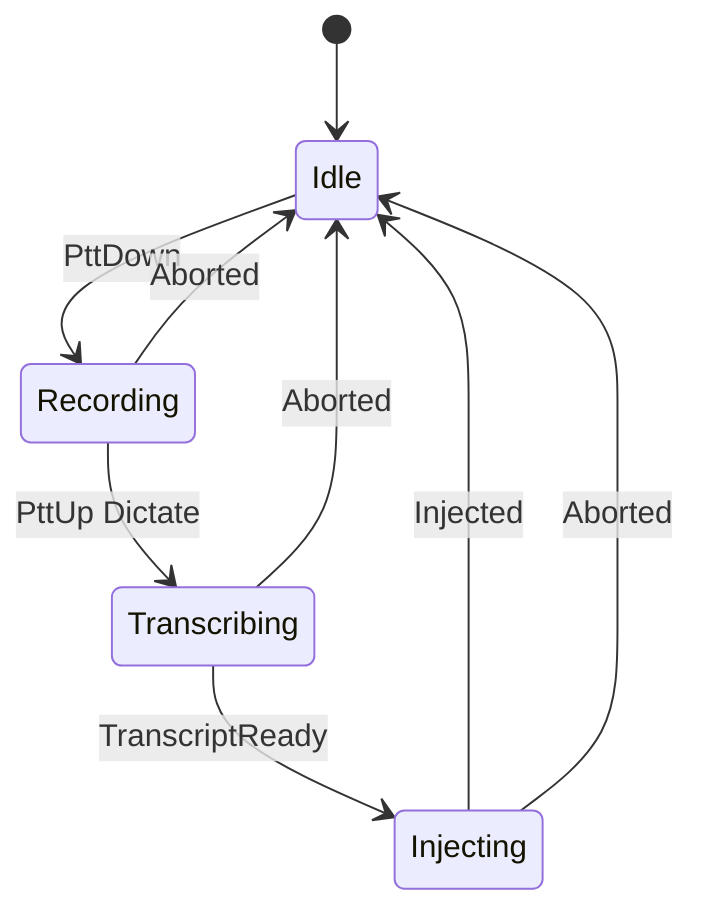

<!-- PAGE_ID: hark_02_architecture -->

Relevant source files

The following files were used as evidence for this page:

- [crates/hark-app/src/main.rs](../../crates/hark-app/src/main.rs)
- [crates/hark-app/src/app.rs](../../crates/hark-app/src/app.rs)
- [crates/hark-app/src/pipeline.rs](../../crates/hark-app/src/pipeline.rs)
- [crates/hark-app/src/pipeline/tests.rs](../../crates/hark-app/src/pipeline/tests.rs)
- [crates/hark-app/src/ui/history/recovery.rs](../../crates/hark-app/src/ui/history/recovery.rs)
- [crates/hark-pipeline/src/lib.rs](../../crates/hark-pipeline/src/lib.rs)
- [crates/hark-pipeline/src/route.rs](../../crates/hark-pipeline/src/route.rs)
- [crates/hark-pipeline/src/plan.rs](../../crates/hark-pipeline/src/plan.rs)
- [crates/hark-pipeline/src/worker.rs](../../crates/hark-pipeline/src/worker.rs)
- [crates/hark-pipeline/src/worker/engines.rs](../../crates/hark-pipeline/src/worker/engines.rs)
- [crates/hark-pipeline/src/worker/shape.rs](../../crates/hark-pipeline/src/worker/shape.rs)
- [crates/hark-pipeline/src/worker/record.rs](../../crates/hark-pipeline/src/worker/record.rs)
- [crates/hark-pipeline/src/worker/held.rs](../../crates/hark-pipeline/src/worker/held.rs)
- [crates/hark-pipeline/src/input.rs](../../crates/hark-pipeline/src/input.rs)
- [crates/hark-pipeline/src/lifecycle.rs](../../crates/hark-pipeline/src/lifecycle.rs)
- [crates/hark-pipeline/src/stream.rs](../../crates/hark-pipeline/src/stream.rs)
- [crates/hark-pipeline/src/state.rs](../../crates/hark-pipeline/src/state.rs)
- [crates/hark-pipeline/src/events.rs](../../crates/hark-pipeline/src/events.rs)
- [crates/hark-pipeline/src/retry.rs](../../crates/hark-pipeline/src/retry.rs)
- [crates/hark-pipeline/src/meeting/mod.rs](../../crates/hark-pipeline/src/meeting/mod.rs)
- [crates/hark-pipeline/src/meeting/coordinator.rs](../../crates/hark-pipeline/src/meeting/coordinator.rs)
- [crates/hark-app/src/meeting.rs](../../crates/hark-app/src/meeting.rs)
- [crates/hark-pipeline/Cargo.toml](../../crates/hark-pipeline/Cargo.toml)

# Architecture

Meeting capture and provider processing use independent workers. A saved-recording
worker can refine retained audio while a new call records; the storage worker
atomically replaces the saved transcript and its search index. The detector is
polled every two seconds on Windows and macOS and woken by PipeWire graph events
on Linux, with independent debounce/auto-stop deadlines. The optional Gemini worker processes bounded mono windows and requests
remote cleanup; a failed pass preserves the prior live transcript.

> **Related Pages**: [Overview](../OVERVIEW.md), [Audio Capture](../features/AUDIO_CAPTURE.md), [Transcription](../features/TRANSCRIPTION.md), [Text Injection](../features/TEXT_INJECTION.md), [Meetings](../features/MEETINGS.md)

---

<!-- BEGIN:AUTOGEN hark_02_architecture_process_model -->
## Process and Threading Model

Hark is one desktop process. The main thread owns eframe, egui, the tray, window state, and UI-side orchestration. Hotkey capture, audio capture, dictation, meeting capture, storage, update checks, and single-instance activation listening run behind channels on worker threads; the UI never performs provider I/O ([main.rs:1-10](../../crates/hark-app/src/main.rs#L1-L10), [app.rs](../../crates/hark-app/src/app.rs), [pipeline.rs](../../crates/hark-app/src/pipeline.rs)).

Startup acquires the single-instance guard, starts the root viewport hidden, and enters `eframe::run_native`. If another normal launch finds Hark running, it signals that instance to show its window and exits; updater and autostart launches deliberately stay silent ([main.rs:43-95](../../crates/hark-app/src/main.rs#L43-L95), [main.rs:97-133](../../crates/hark-app/src/main.rs#L97-L133)). `HarkApp::new` loads settings, opens storage, starts the pipeline and the meeting coordinator, and starts the activation listener. The tray is created on the first event-loop callback so the macOS main-thread requirement is satisfied ([app.rs](../../crates/hark-app/src/app.rs), [app.rs](../../crates/hark-app/src/app.rs)).

`PipelineController` owns the shared listener independently of dictation startup. `spawn_shared_listener` emits `ShortcutEvent`s; an app dispatcher forwards dictation edges into `run_with_input` and meeting toggles to the UI, waking the root viewport even when hidden. `App::logic` forwards each toggle to the meeting coordinator, which decides start versus stop from its current state. Missing dictation credentials or a busy dictation worker therefore do not disable meeting controls ([app dispatcher, pipeline.rs:405-431](../../crates/hark-app/src/pipeline.rs#L405-L431), [its tests](../../crates/hark-app/src/pipeline/tests.rs), [UI event drain](../../crates/hark-app/src/app.rs), [externally owned pipeline input, lib.rs:208-218](../../crates/hark-pipeline/src/lib.rs#L208-L218)).

On macOS, the Quartz event tap owns a worker-thread run loop. AppKit permission controls, native share picker, and overlay placement stay on the main thread. The export worker presents an asynchronous save sheet through the main queue and waits off the UI thread. Microphone authorization is checked before the dictation stream starts; Settings offers permission requests and an explicit retry ([Mac bridge](../../crates/hark-app/src/macos.rs), [native UI](../../crates/hark-app/src/macos/native.m)).

Field order is part of shutdown correctness: the shared listener closes before the dictation worker; pipeline, meeting, and listener handles are declared before the channels and storage handles they feed, so their bounded drops run first — dropping `MeetingController` closes a meeting in progress and lets its final writes reach the storage worker before that worker is joined ([app.rs](../../crates/hark-app/src/app.rs)).

Meeting mode (plan `tasks/2026-09-26-plan-meeting-transcription.md`) is deliberately a separate set of worker threads (the coordinator also announces a pending auto-stop, `AutoStopPending`/`AutoStopCancelled`, once per change rather than per observation; those events are UI-only and never reach the database), not a mode of the dictation pipeline above: `hark-pipeline::meeting::run` starts a **coordinator** thread that owns the detector and the active recording and drains capture every 100 ms, one **live transcriber** thread per meeting that runs chunks through the STT provider FIFO across both channels, and one **finisher** thread per meeting for the after-call work (the selected Deepgram/Gemini final pass, the summary, the MP3 archive), so an older meeting can still be finishing while a new one starts recording ([meeting/mod.rs](../../crates/hark-pipeline/src/meeting/mod.rs)). On the UI side, `hark-app`'s `MeetingController` is the same shape as `PipelineController`: a pump thread receives `MeetingEvent`s, tees database writes to the storage worker, forwards the rest to the UI, and wakes it with `wake_ui` so a hidden window still records every line and shows the detection prompt ([meeting.rs](../../crates/hark-app/src/meeting.rs)). Push-to-talk dictation keeps its own one-shot state machine untouched; their capture and processing state stays separate. They share the app-owned keyboard listener, and meeting toggles do not wait for dictation input to drain.

Sources: [main.rs:43-133](../../crates/hark-app/src/main.rs#L43-L133), [app.rs](../../crates/hark-app/src/app.rs), [pipeline.rs](../../crates/hark-app/src/pipeline.rs), [meeting/mod.rs](../../crates/hark-pipeline/src/meeting/mod.rs), [hark-app/src/meeting.rs](../../crates/hark-app/src/meeting.rs)

Optional meeting echo cancellation is constructed, processed, reset, and dropped
on the meeting worker. The recorder feeds captured playback as a reference and
filters only microphone audio before its spool and live chunker. It uses paired
160-sample frames at 16 kHz with bounded queues; neither the audio callback nor
the dictation worker runs the engine. The existing first-delivery timeline and
automatic engine delay estimate do not provide hardware timestamp pairing or
device-clock drift correction ([recorder](../../crates/hark-pipeline/src/meeting/recorder.rs),
[pairing and bypass](../../crates/hark-pipeline/src/meeting/echo.rs),
[AEC wrapper](../../crates/hark-audio/src/meeting_aec.rs)).

A 128-sample (8 ms) original-microphone guard compensates the engine's fixed
output latency, separately from the 250 ms reference-pairing wait. Startup and
reset discard leading delayed output; stop or fallback writes the retained
original guard before pending microphone audio and any incomplete final frame.
Each drain snapshots which tracks will close before flushing their resampler
and AEC tails. A device error that arrives later is handled by the next drain,
so closure cannot skip that flush ([echo handling](../../crates/hark-pipeline/src/meeting/echo.rs),
[recorder](../../crates/hark-pipeline/src/meeting/recorder.rs)).
<!-- END:AUTOGEN hark_02_architecture_process_model -->

---

<!-- BEGIN:AUTOGEN hark_02_architecture_pipeline -->
## The Release-to-Inject Pipeline

`hark_pipeline::run` builds the shared blocking HTTP client, cleanup plan, batch STT adapter, optional live adapter, continuous capture, native hook, and long-lived worker. A local-primary configuration is keyless and does not construct a cloud adapter; cloud-backed modes resolve their secret before the hook starts ([lib.rs:196-348](../../crates/hark-pipeline/src/lib.rs#L196-L348)). `lib.rs` keeps the handle and the startup sequence; two helper modules build the parts. `route.rs` decides which adapter and model the STT settings select, for the stream, for its batch fallback, and for a meeting's live chunks. `plan.rs` builds the invocation expander, the cleanup plan, the on-device plan, the live adapter, and the window and injection parameters ([route.rs:1-3](../../crates/hark-pipeline/src/route.rs#L1-L3), [plan.rs:1-3](../../crates/hark-pipeline/src/plan.rs#L1-L3)).

Before it waits for the chord, the worker thread starts two pieces of warm-up. When the on-device mode is Backup or Primary and the model is on disk, it asks a helper thread to read the model into memory, so the first dictation or first rescue does not pay the load; nothing on the worker waits for that thread. It then pre-warms the HTTP connection to the STT provider, and to the cleanup provider when that is a different host ([worker.rs:126-145](../../crates/hark-pipeline/src/worker.rs#L126-L145), [On-Device STT](../features/ON_DEVICE_STT.md#residency)).

A small input worker observes edges independently of blocking transcription. It stamps accepted edges with the ring's current absolute position and reserves the entire hold/completion cycle before forwarding key-down. A hold begun while occupied stays rejected through release, even if the previous dictation finishes during that hold. Aborted and completed cycles reopen admission ([input](../../crates/hark-pipeline/src/input.rs), [lifecycle](../../crates/hark-pipeline/src/lifecycle.rs), [worker](../../crates/hark-pipeline/src/worker.rs)). The channel the worker blocks on carries a `WorkerInput`: an admitted edge, or one of two requests from the UI about a clip held after a failed transcription (`RetryHeld`, `DismissHeld`). It is one merged channel because std's `mpsc` has no select and the worker must wake for either ([input.rs:14-24](../../crates/hark-pipeline/src/input.rs#L14-L24), [input.rs:54-80](../../crates/hark-pipeline/src/input.rs#L54-L80)).

With a live adapter (Gemini Live, or OpenAI with Live transcribe on), key-down opens a live session and pumps PCM from the ring while the user is speaking. The pump resamples straight from the device rate to the rate the provider declares through `LiveStt::input_rate()`: 16 kHz for Gemini, 24 kHz for OpenAI's realtime API, which accepts nothing else. The assembled clip stays 16 kHz. The live path is only an accelerator: failure to open, send, keep up, or finish drops back to the ordinary batch path because streaming reads rather than consumes the ring. For OpenAI that batch path is gpt-transcribe over REST, which an empty live transcript also falls back to ([stream.rs:1-31](../../crates/hark-pipeline/src/stream.rs#L1-L31), [stream.rs:41-176](../../crates/hark-pipeline/src/stream.rs#L41-L176), [Transcription](../features/TRANSCRIPTION.md#openai-live-transcribe)). Other providers begin at key-up.

After release the worker assembles and gates the same audio window, finalizes live STT or encodes WAV and runs batch/local STT, corrects the transcript, expands invocations, conditionally applies voice cleanup (discarding a response that grew the text or answered it instead of editing it), injects the final text, and emits a history record. A replay after live failure consumes the same single retry budget as any batch retry ([worker.rs:398-611](../../crates/hark-pipeline/src/worker.rs#L398-L611)). `dictate` in `worker.rs` is the sequence; its steps live in three submodules, which a retry of a held clip reuses so both go through exactly the same path:

| Step | Module |
|---|---|
| Cloud request with its single retry, and the on-device engine, bound to the cloud/local policy | [worker/engines.rs](../../crates/hark-pipeline/src/worker/engines.rs) |
| Spellbook pass 1, invocations, optional cleanup with spellbook pass 2, and the single-word period | [worker/shape.rs](../../crates/hark-pipeline/src/worker/shape.rs) |
| The `DictationRecord`, naming the engine, model and voice that actually produced the text | [worker/record.rs](../../crates/hark-pipeline/src/worker/record.rs) |

The record is built before the worker looks at the injection result, so the text survives a failed paste: success emits `Injected`, and a paste error emits `NotPasted` with the same record ([worker.rs:563-610](../../crates/hark-pipeline/src/worker.rs#L563-L610)).

Sources: [lib.rs:196-348](../../crates/hark-pipeline/src/lib.rs#L196-L348), [worker.rs:126-286](../../crates/hark-pipeline/src/worker.rs#L126-L286), [worker.rs:398-611](../../crates/hark-pipeline/src/worker.rs#L398-L611), [stream.rs:1-176](../../crates/hark-pipeline/src/stream.rs#L1-L176)
<!-- END:AUTOGEN hark_02_architecture_pipeline -->

---

<!-- BEGIN:AUTOGEN hark_02_architecture_state -->
## Pipeline State Machine

The dictation cycle is a pure, total state machine: every `(state, event)` pair is defined, so duplicate, stray, or reordered hook events are inert rather than fatal ([state.rs:46-87](../../crates/hark-pipeline/src/state.rs#L46-L87)).

| State | Meaning | Source |
|---|---|---|
| `Idle` | Listening; no chord held | [state.rs:9](../../crates/hark-pipeline/src/state.rs#L9) |
| `Recording { down_abs }` | Chord held; capture continues and live STT may be pumping | [state.rs:10](../../crates/hark-pipeline/src/state.rs#L10) |
| `Transcribing` | Release observed; live finalization, local STT, or batch STT is running | [state.rs:11](../../crates/hark-pipeline/src/state.rs#L11) |
| `Injecting` | Text is ready and injection is running | [state.rs:12](../../crates/hark-pipeline/src/state.rs#L12) |

Every state aborts directly to `Idle`. A duplicate down edge preserves the original sample index. The input observer rejects busy holds before queueing, because the synchronous worker cannot drain hotkeys during transcription or injection ([state](../../crates/hark-pipeline/src/state.rs), [input admission](../../crates/hark-pipeline/src/input.rs)).

`PipelineEvent` is an advisory UI protocol, not the state machine itself. It also reports local-model loading, shortcut interception, and what happened to a dictation that did not reach the cursor, none of which changes the dictation states ([events.rs:82-124](../../crates/hark-pipeline/src/events.rs#L82-L124)). A retry of a held clip does not go through the state machine either: it runs only while the machine is `Idle` and reserves the cycle directly, so a chord pressed during it is refused like any other busy hold ([worker/held.rs:25-39](../../crates/hark-pipeline/src/worker/held.rs#L25-L39)).

Sources: [state.rs:1-88](../../crates/hark-pipeline/src/state.rs#L1-L88), [events.rs:82-124](../../crates/hark-pipeline/src/events.rs#L82-L124)
<!-- END:AUTOGEN hark_02_architecture_state -->

---

<!-- BEGIN:AUTOGEN hark_02_architecture_events -->
## Events and UI Bridge

The pipeline sends best-effort events through a non-blocking channel. `DictationRecord` intentionally has no `Debug` implementation, preventing transcript content from entering logs through accidental debug formatting ([events.rs:1-47](../../crates/hark-pipeline/src/events.rs#L1-L47)).

The pipeline's events, and what each does to the status footer ([events.rs:82-124](../../crates/hark-pipeline/src/events.rs#L82-L124), [`next_status`, pipeline.rs:447-502](../../crates/hark-app/src/pipeline.rs#L447-L502)):

| `PipelineEvent` | Meaning | Footer status |
|---|---|---|
| `Recording` | The chord went down; audio is being captured | `Recording` |
| `Processing` | The chord released and the request is in flight. Also the first event of a retry of a held clip, so the footer does not say "ready" while the chord is refused | `Processing` |
| `LoadingLocalModel` | A dictation is about to wait for the on-device model to finish loading | `LoadingModel` |
| `Injected(record)` | The text was pasted; the record goes to history | `Idle` |
| `Failed { stage, detail }` | The dictation ended without text | By stage; see [Failure Modes](#failure-modes) |
| `NotPasted { record, detail }` | The words were transcribed, corrected and cleaned, but the paste failed. Carries the record so the text is not thrown away | `Errored`: "Couldn't paste. Open History to copy the text." |
| `ClipHeld { held }` | Whether the worker is holding the audio of a dictation whose transcription failed | Unchanged |
| `Recovered(record)` | A retry of the held clip produced text. It was not pasted | `Idle` |
| `ShortcutIntercepted { key }` | Another program is intercepting a push-to-talk key | Unchanged |

| `PipelineStatus` | Meaning |
|---|---|
| `Idle` | Running and waiting for the chord |
| `Recording` | Chord held and capturing |
| `Processing` | Release observed; STT and downstream work are running |
| `LoadingModel` | A dictation is waiting for the on-device model to load |
| `Hint` | A non-error outcome worth saying: nothing loud enough to be speech was captured |
| `Errored` | The last dictation failed; sticky until the next dictation |
| `Stopped` | Pipeline is not running because startup or configuration failed |

The event-pump thread publishes each event to the recording overlay, tees records to the storage worker, forwards the event to the UI, and wakes it. `PipelineController::drain_events` maps events to the statuses above and keeps the History banner's slot in step. `ShortcutIntercepted` and `ClipHeld` are advisory: they do not replace the current status ([pump, pipeline.rs:528-563](../../crates/hark-app/src/pipeline.rs#L528-L563), [drain_events, pipeline.rs:289-315](../../crates/hark-app/src/pipeline.rs#L289-L315), [PipelineStatus, pipeline.rs:13-40](../../crates/hark-app/src/pipeline.rs#L13-L40)).

Sources: [events.rs:1-124](../../crates/hark-pipeline/src/events.rs#L1-L124), [pipeline.rs:13-40](../../crates/hark-app/src/pipeline.rs#L13-L40), [pipeline.rs:289-328](../../crates/hark-app/src/pipeline.rs#L289-L328), [pipeline.rs:447-563](../../crates/hark-app/src/pipeline.rs#L447-L563)
`DictationRecord` now also carries measured Spellbook replacement counts and an optional foreground app label. With `[insights] track_apps` enabled, the pipeline requests one app-identity snapshot at engagement from a bounded helper worker, polls its result only after insertion, and drops unfinished/late metadata. This probe never reads window titles, runs continuously, or blocks audio/hooks/injection. On X11 it uses pure-Rust `x11rb` 0.14, so no libX11/XCB is linked. Disabled tracking makes no OS request. Wayland and remote X11 identities remain unknown ([probe](../../crates/hark-pipeline/src/foreground.rs), [worker](../../crates/hark-pipeline/src/worker.rs)).

The event pump forwards completed records to the storage worker for transcript capture, numeric event storage, and lifetime counters. Home/Insights query that worker through reply channels; aggregation and opted-in word analysis stay off the egui thread, and results explicitly wake the root viewport. Cached UI queries change with generation, selected range, local date, or text-analysis choice ([storage](../../crates/hark-app/src/storage/mod.rs), [cache](../../crates/hark-app/src/ui/insights_cache.rs)).
<!-- END:AUTOGEN hark_02_architecture_events -->

---

<!-- BEGIN:AUTOGEN hark_02_architecture_retry -->
## Retry and Latency Discipline

Latency is the product, so a dictation has one retry budget. Only timeouts and connect-class transport errors are eligible; authentication, rate limiting, bad audio, provider errors, and mid-request transport failures are not ([retry.rs:1-30](../../crates/hark-pipeline/src/retry.rs#L1-L30)).

| `SttError` variant | Retried? | Why |
|---|---|---|
| `Timeout` | Yes | The request may not have reached the provider |
| `Http` with `connect failed` prefix | Yes | DNS, refused, unreachable, or TLS setup may be transient |
| Other `Http` | No | The request may already have reached the provider |
| `Auth`, `RateLimited`, `BadAudio`, `Provider` | No | An immediate replay cannot safely repair them |

A failed live session may fall back to batch, but that replay consumes the one retry. The batch helper has no loop and can make at most one additional call ([worker.rs:455-518](../../crates/hark-pipeline/src/worker.rs#L455-L518), [worker/engines.rs:96-119](../../crates/hark-pipeline/src/worker/engines.rs#L96-L119)). The shared client preserves connections across dictations, and streaming uploads most audio before release when available ([lib.rs:228](../../crates/hark-pipeline/src/lib.rs#L228), [stream.rs:145-155](../../crates/hark-pipeline/src/stream.rs#L145-L155)).

The waits themselves are bounded per request, sized to what is being waited for rather than one flat number:

| Wait | Bound | Where |
|---|---|---|
| A dictation's batch STT request | 6 s plus half the clip's length, capped at 15 s | `dictation_timeout_ms`, [hark-stt lib.rs:43-51](../../crates/hark-stt/src/lib.rs#L43-L51) |
| The same request when on-device Backup is armed and ready | `local_stt.fallback_after_ms` (default 6 s), whatever the clip length | [lib.rs:248-273](../../crates/hark-pipeline/src/lib.rs#L248-L273) |
| Finalising a Gemini Live turn streamed during the hold | 1.5 s of silence between frames, 15 s in total | [gemini_live/budget.rs:16-31](../../crates/hark-stt/src/gemini_live/budget.rs#L16-L31) |
| Finalising an OpenAI live turn streamed during the hold | 3 s of silence between frames, 15 s in total | [openai_live/budget.rs:19-29](../../crates/hark-stt/src/openai_live/budget.rs#L19-L29) |
| The cleanup request | 4 s plus 5 ms per input character, capped at 10 s | `cleanup_timeout_ms`, [hark-voice lib.rs:38-57](../../crates/hark-voice/src/lib.rs#L38-L57) |

Before these, a hung batch request cost the full 15 s on every attempt and a retry doubled it, and a hung cleanup call cost 10 s even for a one-word dictation. The details are in [Transcription](../features/TRANSCRIPTION.md#batch-and-live-provider-traits) and [Voice Cleanup](../features/VOICE_CLEANUP.md#cleanup-adapter).

Sources: [retry.rs:1-30](../../crates/hark-pipeline/src/retry.rs#L1-L30), [worker.rs:455-518](../../crates/hark-pipeline/src/worker.rs#L455-L518), [worker/engines.rs:96-119](../../crates/hark-pipeline/src/worker/engines.rs#L96-L119), [stream.rs:145-155](../../crates/hark-pipeline/src/stream.rs#L145-L155)
`LiveTurn` retains whether a session was attempted independently of its pump. A failed open or mid-hold send therefore permits one batch replay and no further batch retry. Cancellation is rechecked before retries, local fallback, cleanup, and injection; a response already in flight may finish but cannot start the next stage after cancellation ([stream](../../crates/hark-pipeline/src/stream.rs), [worker](../../crates/hark-pipeline/src/worker.rs)).
<!-- END:AUTOGEN hark_02_architecture_retry -->

---

<!-- BEGIN:AUTOGEN hark_02_architecture_failure -->
## Failure Modes

A dictation that ends without text reports a `FailStage`. Details are display-safe summaries; key material, raw audio, and transcript content remain absent from logs ([events.rs:49-80](../../crates/hark-pipeline/src/events.rs#L49-L80)).

| `FailStage` | Trigger | User-visible surface |
|---|---|---|
| `GatedTooShort` | Tap or misfire | Return quietly to `Idle` |
| `GatedTooQuiet` | No speech-level signal | Show a non-error microphone hint |
| `Audio` | Window assembly or resampling failed | Show `Errored` |
| `Transcribe` | STT failed after its retry budget | Show `Errored` with "Try again from History."; the clip is held (below) |
| `EmptyTranscript` | Provider returned no text | Return to `Idle` |
| `Inject` | Kept in the enum and still handled by the app, but the worker no longer emits it: a failed paste is `NotPasted` (below) | Show `Errored` |
| `Abandoned` | Release was lost and the hold exceeded its maximum | Return to `Idle` |
| `Internal` | A dictation, or a retry of a held clip, panicked | Show `Errored`; keep the worker alive |

`dictate_guarded` catches per-dictation panics, emits `Internal`, and returns the state machine to `Idle` rather than killing the long-lived worker ([worker.rs:348-396](../../crates/hark-pipeline/src/worker.rs#L348-L396)). Startup errors are separate: `PipelineController::start` maps a bad key, bad provider configuration, or capture failure to `Stopped`, leaving the application usable ([pipeline.rs:133-234](../../crates/hark-app/src/pipeline.rs#L133-L234)). Pipeline drop uses bounded joins so a stuck request cannot hold application shutdown forever ([lib.rs:157-194](../../crates/hark-pipeline/src/lib.rs#L157-L194)).

### Recovering a dictation that did not arrive

Two failures used to throw the user's words away. Both now end in History instead.

**The paste failed.** The words were transcribed, spellbook-corrected and cleaned; only the injection into the focused app failed. The worker emits `NotPasted { record, detail }` instead of `Failed { stage: Inject }`. `record` is the complete `DictationRecord`, and `detail` is an error summary, never transcript text ([worker.rs:588-610](../../crates/hark-pipeline/src/worker.rs#L588-L610), [events.rs:99-106](../../crates/hark-pipeline/src/events.rs#L99-L106)).

**The transcription failed.** When the STT step fails for good, the worker keeps that one clip in memory as a `HeldClip`: the 16 kHz mono samples as they went to the engines, the clip length, and the foreground app label if the user opted in. It then emits `ClipHeld { held: true }` after the `Failed { stage: Transcribe }`. The clip is never written to disk and never logged. There is at most one. Gated, empty, abandoned and audio-assembly failures never produce one, because there is nothing worth transcribing again ([worker.rs:520-535](../../crates/hark-pipeline/src/worker.rs#L520-L535), [worker/held.rs:12-23](../../crates/hark-pipeline/src/worker/held.rs#L12-L23)).

The UI asks about the held clip through two fire-and-forget methods on `PipelineHandle`, which put a `WorkerInput` on the worker's own channel ([lib.rs:90-110](../../crates/hark-pipeline/src/lib.rs#L90-L110)):

| Call | What the worker does |
|---|---|
| `retry_held_clip()` | Transcribes the clip again, then runs the same spellbook, invocation and cleanup steps as a live dictation. Text comes back as `Recovered(record)`. Nothing is pasted |
| `dismiss_held_clip()` | Drops the clip. No reply |

A retry obeys four rules ([worker/held.rs:25-132](../../crates/hark-pipeline/src/worker/held.rs#L25-L132)):

- **It runs only while the worker is idle.** A retry blocks the worker for as long as a transcription takes, so it must never race a dictation for the cycle. If a dictation is in progress the request is declined and answered with `ClipHeld { held: true }`.
- **It announces itself.** `Processing` is sent first, because the chord is refused until the retry finishes and the footer would otherwise say "ready" while a press does nothing.
- **It makes one cloud attempt.** There is no retry of the retry: the clip already failed a full attempt plus retry once. The on-device fallback still applies when the mode allows it.
- **It never pastes.** The user asked from Hark's own window, so the cursor is no longer where the dictation was aimed. The text is the UI's to keep.

The worker always answers a retry request, so the UI's busy state cannot stick: `Recovered` on success; `Failed` then `ClipHeld { held: true }` when it fails (the clip is kept for another try); `ClipHeld { held: false }` when there was nothing to retry. The clip is also dropped, with `ClipHeld { held: false }`, when a later dictation produces words, since the user has moved on, and it goes with the worker when the pipeline stops ([worker.rs:553-557](../../crates/hark-pipeline/src/worker.rs#L553-L557), [events.rs:107-118](../../crates/hark-pipeline/src/events.rs#L107-L118), [worker/held_tests.rs](../../crates/hark-pipeline/src/worker/held_tests.rs)).

On the app side the controller owns the only path to the pipeline handle. It keeps a one-slot `Recovery` state in step with the event stream, shares it with the History page through the egui context, and forwards the page's Retry or Dismiss click on the next `drain_events` pass. History shows a banner for the last undelivered dictation: **Copy text** for a failed paste, **Try again** for a held clip. Stopping the pipeline clears a held-audio banner, because the clip went with the worker; a text banner outlives the pipeline ([pipeline.rs:317-328](../../crates/hark-app/src/pipeline.rs#L317-L328), [recovery.rs:49-119](../../crates/hark-app/src/ui/history/recovery.rs#L49-L119), [Desktop UI](../features/DESKTOP_UI.md#home-insights-and-editors)). Both kinds of text are stored as History rows flagged `delivered = false` when history capture is on ([Data Storage](DATA_STORAGE.md#history-api)).

Sources: [events.rs:49-124](../../crates/hark-pipeline/src/events.rs#L49-L124), [state.rs:46-87](../../crates/hark-pipeline/src/state.rs#L46-L87), [pipeline.rs:133-234](../../crates/hark-app/src/pipeline.rs#L133-L234), [worker.rs:348-396](../../crates/hark-pipeline/src/worker.rs#L348-L396), [worker/held.rs:1-132](../../crates/hark-pipeline/src/worker/held.rs#L1-L132), [lib.rs:157-194](../../crates/hark-pipeline/src/lib.rs#L157-L194)
Drop marks the run cancelled before its bounded join. Injection admission and cancellation share an atomic state: cancellation that wins prevents clipboard mutation; an already-admitted paste finishes restoration. A worker-only mutex serializes paste transactions across old and new pipeline runs without making stop acquire that lock. Externally supplied input must close its sender before dropping the handle. The handle's own sender for held-clip requests is dropped first for the same reason: while it lives the worker's `recv` cannot disconnect, and the join would wait out its whole grace ([lifecycle](../../crates/hark-pipeline/src/lifecycle.rs), [pipeline handle, lib.rs:66-88](../../crates/hark-pipeline/src/lib.rs#L66-L88), [drop order, lib.rs:157-176](../../crates/hark-pipeline/src/lib.rs#L157-L176), [regressions](../../crates/hark-pipeline/src/worker/recovery_tests.rs)).
<!-- END:AUTOGEN hark_02_architecture_failure -->

---
