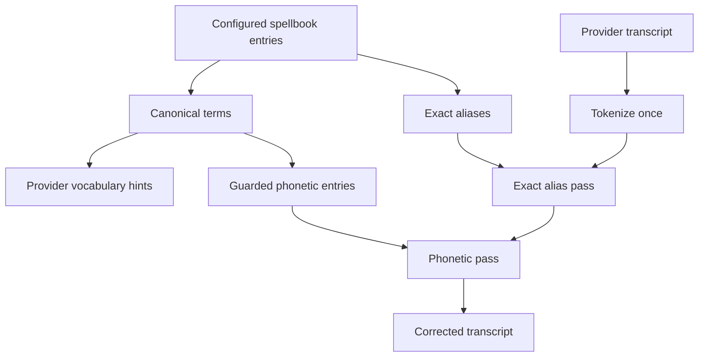

<!-- PAGE_ID: hark_08_spellbook -->

Relevant source files

The following files were used as evidence for this page:

- [crates/hark-spellbook/src/lib.rs:1-193](../../crates/hark-spellbook/src/lib.rs#L1-L193)
- [crates/hark-spellbook/src/matcher.rs:1-238](../../crates/hark-spellbook/src/matcher.rs#L1-L238)
- [crates/hark-spellbook/src/tokenize.rs:1-146](../../crates/hark-spellbook/src/tokenize.rs#L1-L146)
- [crates/hark-spellbook/src/snap.rs:1-107](../../crates/hark-spellbook/src/snap.rs#L1-L107)
- [crates/hark-spellbook/src/expander.rs:1-314](../../crates/hark-spellbook/src/expander.rs#L1-L314)
- [crates/hark-config/src/spellbook.rs:1-82](../../crates/hark-config/src/spellbook.rs#L1-L82)
- [crates/hark-config/src/load_save.rs](../../crates/hark-config/src/load_save.rs)
- [crates/hark-pipeline/src/lib.rs](../../crates/hark-pipeline/src/lib.rs)
- [crates/hark-pipeline/src/route.rs](../../crates/hark-pipeline/src/route.rs)
- [crates/hark-stt/src/openai_compatible.rs:57-90](../../crates/hark-stt/src/openai_compatible.rs#L57-L90)
- [crates/hark-stt/src/openai_transcribe.rs:63-85](../../crates/hark-stt/src/openai_transcribe.rs#L63-L85)
- [crates/hark-stt/src/deepgram.rs:39-57](../../crates/hark-stt/src/deepgram.rs#L39-L57)
- [crates/hark-stt/src/gemini_live/wire.rs:12-51](../../crates/hark-stt/src/gemini_live/wire.rs#L12-L51)
- [crates/hark-stt/src/openai_live/wire.rs:54-107](../../crates/hark-stt/src/openai_live/wire.rs#L54-L107)
- [crates/hark-app/src/ui/spellbook/mod.rs:1-332](../../crates/hark-app/src/ui/spellbook/mod.rs#L1-L332)
- [crates/hark-app/src/ui/spellbook/edit.rs](../../crates/hark-app/src/ui/spellbook/edit.rs)
- [crates/hark-app/src/ui/history/selection.rs](../../crates/hark-app/src/ui/history/selection.rs) and [crates/hark-app/src/ui/selectable.rs](../../crates/hark-app/src/ui/selectable.rs)
- [crates/hark-app/src/ui/spellbook/book.rs](../../crates/hark-app/src/ui/spellbook/book.rs) and [crates/hark-app/src/ui/book.rs](../../crates/hark-app/src/ui/book.rs)
- [crates/hark-pipeline/src/meeting/live.rs:54-319](../../crates/hark-pipeline/src/meeting/live.rs#L54-L319)
- [crates/hark-pipeline/src/meeting/finish.rs](../../crates/hark-pipeline/src/meeting/finish.rs)

# Spellbook

Meetings apply the same phonetic corrector to live lines, Deepgram refinements,
and Gemini Files window results. Explicit reprocessing of saved audio uses the
current spellbook; vocabulary hints may accompany provider requests. Invocation
expansions remain disabled for every meeting path
([live](../../crates/hark-pipeline/src/meeting/live.rs),
[rerun](../../crates/hark-pipeline/src/meeting/rerun.rs),
[Gemini](../../crates/hark-pipeline/src/meeting/gemini_final.rs)).

> **Related Pages**: [Transcription](TRANSCRIPTION.md), [Invocations](INVOCATIONS.md), [Voice Cleanup](VOICE_CLEANUP.md), [Configuration and Secrets](../core/CONFIGURATION.md), [Meetings](MEETINGS.md)

---

<!-- BEGIN:AUTOGEN hark_08_spellbook_overview -->
## Overview

The spellbook is Hark's user-owned vocabulary. Each configuration entry has a canonical `term` and optional exact `aliases` for known mishearings. Canonical terms serve two independent paths: Hark post-corrects returned transcripts locally, and it sends the same terms to the selected STT provider as vocabulary hints. Aliases stay local because asking a provider to favor a known misspelling would work against the correction ([hark-config spellbook.rs:53-70](../../crates/hark-config/src/spellbook.rs#L53-L70)). Config schema 6 adds the independent meeting echo setting while preserving these entries ([migration](../../crates/hark-config/src/meeting.rs)).

The `hark-spellbook` crate is pure text processing: no network, disk, or async runtime. `Corrector` precomputes match data when the pipeline starts and applies exact aliases before guarded phonetic inference for every transcript ([lib.rs:1-16](../../crates/hark-spellbook/src/lib.rs#L1-L16), [lib.rs:31-65](../../crates/hark-spellbook/src/lib.rs#L31-L65), [lib.rs:91-107](../../crates/hark-spellbook/src/lib.rs#L91-L107)).

Pipeline construction passes canonical terms into `ProviderConfig.bias_terms` and `(term, aliases)` pairs into `Corrector::new`; editing the spellbook persists the new entries and restarts the pipeline so both precomputed views update together ([`provider_config`, route.rs:85-91](../../crates/hark-pipeline/src/route.rs#L85-L91), [pipeline lib.rs:313](../../crates/hark-pipeline/src/lib.rs#L313), [mod.rs:1-17](../../crates/hark-app/src/ui/spellbook/mod.rs#L1-L17)).

Correction is not limited to dictation. Meeting mode builds a `Corrector` from the same `settings.spellbook.corrector_entries()` and applies it to every meeting line — the live transcriber's chunks as they arrive, and the Deepgram final pass's diarized lines once it replaces them — so a spellbook term fixes a mishearing in a meeting exactly as it would in a dictation ([live.rs:54-58](../../crates/hark-pipeline/src/meeting/live.rs#L54-L58), [live.rs:317-318](../../crates/hark-pipeline/src/meeting/live.rs#L317-L318), [finish.rs](../../crates/hark-pipeline/src/meeting/finish.rs)). Invocations are the deliberate exception: they never fire in meeting mode, because a trigger phrase is dictation control flow, not a correction ([Meetings](MEETINGS.md#live-transcript)).

Sources: [crates/hark-config/src/spellbook.rs:53-70](../../crates/hark-config/src/spellbook.rs#L53-L70), [crates/hark-spellbook/src/lib.rs:1-167](../../crates/hark-spellbook/src/lib.rs#L1-L167), [crates/hark-pipeline/src/route.rs:63-101](../../crates/hark-pipeline/src/route.rs#L63-L101), [crates/hark-pipeline/src/lib.rs:313](../../crates/hark-pipeline/src/lib.rs#L313), [crates/hark-pipeline/src/meeting/live.rs:54-319](../../crates/hark-pipeline/src/meeting/live.rs#L54-L319), [crates/hark-pipeline/src/meeting/finish.rs](../../crates/hark-pipeline/src/meeting/finish.rs)
Insights → Your voice displays the current vocabulary size and measured dictionary-correction total. The pipeline counts actual replacements in the first and, when applicable, second Spellbook passes and stores only the count after successful insertion. Older backfilled rows keep an unknown correction count; provider cleanup changes are not counted as Spellbook fixes. This is a usage measure, not an accuracy percentage ([`corrected_text`, worker/shape.rs:198-208](../../crates/hark-pipeline/src/worker/shape.rs#L198-L208), [worker/record.rs:74-76](../../crates/hark-pipeline/src/worker/record.rs#L74-L76), [numeric fields](../../crates/hark-store/src/insights/types.rs)).
<!-- END:AUTOGEN hark_08_spellbook_overview -->

---

<!-- BEGIN:AUTOGEN hark_08_spellbook_matcher -->
## Phonetic Matcher

`Corrector` performs two ordered passes over one tokenization. The alias pass is exact and runs first; an alias is an explicit user instruction, so its claimed tokens cannot later be taken by a competing phonetic term. Aliases and canonical terms are both sorted longest-first to make multi-word matches win overlaps ([matcher.rs:99-168](../../crates/hark-spellbook/src/matcher.rs#L99-L168), [lib.rs:85-107](../../crates/hark-spellbook/src/lib.rs#L85-L107)).

Canonical term words choose their matching path at construction:

| Path | Eligibility | Rule |
|---|---|---|
| Exact-only | Fewer than four characters, contains a digit/non-letter, or cannot be usefully encoded | Lowercased token text must be equal |
| Phonetic | At least four Unicode alphabetic characters with a non-empty code | A primary/alternate Double Metaphone code intersects and Jaro-Winkler similarity is at least 0.85 |

Equal spellings always match without needing phonetic confirmation. Empty phonetic codes never match ([matcher.rs:170-210](../../crates/hark-spellbook/src/matcher.rs#L170-L210), [matcher.rs:228-238](../../crates/hark-spellbook/src/matcher.rs#L228-L238)). Invocations reuse this matcher at the stricter 0.90 threshold because a false positive can paste a whole canned response rather than rewrite one term ([expander.rs:17-31](../../crates/hark-spellbook/src/expander.rs#L17-L31)).

Before calling `rphonetic`, Hark folds input to the ASCII domain the library expects. Typographic apostrophes/quotes/dashes map to ASCII counterparts, common accented Latin letters map to bases, and other scripts or emoji are dropped; a resulting empty code falls back to exact-only matching. This prevents a multibyte character from triggering an invalid UTF-8 byte slice inside `rphonetic` while keeping cases such as `müller`/`muller` phonetically comparable ([matcher.rs:29-75](../../crates/hark-spellbook/src/matcher.rs#L29-L75)).

Sources: [crates/hark-spellbook/src/lib.rs:31-167](../../crates/hark-spellbook/src/lib.rs#L31-L167), [crates/hark-spellbook/src/matcher.rs:29-75](../../crates/hark-spellbook/src/matcher.rs#L29-L75), [crates/hark-spellbook/src/matcher.rs:99-238](../../crates/hark-spellbook/src/matcher.rs#L99-L238), [crates/hark-spellbook/src/expander.rs:17-31](../../crates/hark-spellbook/src/expander.rs#L17-L31)
<!-- END:AUTOGEN hark_08_spellbook_matcher -->

---

<!-- BEGIN:AUTOGEN hark_08_spellbook_tokenize -->
## Tokenization

A token stores the byte range of a word core in the original transcript plus a lowercase comparison copy. Punctuation outside the first and last alphanumeric character is excluded from the range, so splicing a canonical term preserves surrounding punctuation without reconstructing it ([tokenize.rs:1-20](../../crates/hark-spellbook/src/tokenize.rs#L1-L20), [tokenize.rs:28-52](../../crates/hark-spellbook/src/tokenize.rs#L28-L52)).

The tokenizer splits on whitespace and then on interior ASCII hyphens. It preserves byte-accurate spans for Unicode text and keeps interior apostrophes inside a word core.

| Input | Comparable tokens | Consequence |
|---|---|---|
| `modero, then` | `modero`, `then` | The comma survives replacement |
| `run hark-stt now` | `run`, `hark`, `stt`, `now` | One term shape matches spaced or hyphenated speech |
| `don't stop` | `don't`, `stop` | Interior apostrophe stays in the core |
| `müller café.` | `müller`, `café` | Unicode spans and lowercasing remain valid |
| `... -- !?` | none | Punctuation-only input is a no-op |

These cases are covered directly by tokenizer tests ([tokenize.rs:63-145](../../crates/hark-spellbook/src/tokenize.rs#L63-L145)). History selection uses the same tokenizer through `snap_to_tokens` and `snapped_text`, converting egui character ranges to token-aligned text so a clipped drag cannot create a correction the matcher will never see ([snap.rs:1-17](../../crates/hark-spellbook/src/snap.rs#L1-L17), [snap.rs:51-107](../../crates/hark-spellbook/src/snap.rs#L51-L107)).

Sources: [crates/hark-spellbook/src/tokenize.rs:1-145](../../crates/hark-spellbook/src/tokenize.rs#L1-L145), [crates/hark-spellbook/src/snap.rs:1-107](../../crates/hark-spellbook/src/snap.rs#L1-L107)
Canonical edge punctuation already adjacent to a matched core is reused rather
than inserted again. `C++`, `C#`, and `.NET` therefore survive both correction
passes unchanged, including when the first pass inserts the term through an
alias. Quotes, brackets, and sentence punctuation remain outside the splice;
neighboring matches cannot claim overlapping byte ranges
([corrector and regressions](../../crates/hark-spellbook/src/lib.rs)).
<!-- END:AUTOGEN hark_08_spellbook_tokenize -->

---

<!-- BEGIN:AUTOGEN hark_08_spellbook_biasing -->
## Provider Biasing

Only canonical terms become provider hints; aliases are known-wrong forms and remain local. `provider_config` copies `Settings.spellbook.terms()` into the provider-neutral `bias_terms` list, after which each adapter maps that list onto its own wire contract ([hark-config spellbook.rs:54-60](../../crates/hark-config/src/spellbook.rs#L54-L60), [pipeline route.rs:85-91](../../crates/hark-pipeline/src/route.rs#L85-L91)).

| Adapter path | Wire representation | Limit/ordering behavior |
|---|---|---|
| Whisper-family OpenAI-compatible | One comma-separated multipart `prompt` | Keeps entry order until an approximate 200-token/800-character budget is reached ([openai_compatible.rs:62-90](../../crates/hark-stt/src/openai_compatible.rs#L62-L90)) |
| `gpt-transcribe` | One multipart `keywords[]` field per term | No Hark-side term cap or prompt packing ([openai_transcribe.rs:63-85](../../crates/hark-stt/src/openai_transcribe.rs#L63-L85)) |
| Deepgram Nova | One URL query `keyterm` per term | URL-encoded, repeated, and unbounded by Hark ([deepgram.rs:39-57](../../crates/hark-stt/src/deepgram.rs#L39-L57)) |
| Gemini Live | `inputAudioTranscription.customVocabulary` array | Omitted when empty and capped at the API's 1,000-phrase limit ([gemini_live/wire.rs:12-51](../../crates/hark-stt/src/gemini_live/wire.rs#L12-L51)) |
| OpenAI live (`gpt-live-transcribe`) | `audio.input.transcription.keywords` array in `session.update` | Sanitized first, because one term with `<`, `>` or a line break rejects the whole session: those characters are dropped, control characters become spaces, whitespace collapses, empty and duplicate terms are dropped, and the array is omitted when empty. Only counts are logged ([`sanitize_keywords` and `session_update`, openai_live/wire.rs:54-107](../../crates/hark-stt/src/openai_live/wire.rs#L54-L107), [`OpenAiLive::new`, openai_live.rs:179-188](../../crates/hark-stt/src/openai_live.rs#L179-L188)) |

The model selects the two OpenAI multipart contracts: `gpt-transcribe` routes to discrete `keywords[]`, while Whisper-family models and compatible endpoints retain the glossary prompt. Gemini Live and OpenAI live are separate WebSocket adapters and send the vocabulary in their session setup message. OpenAI live is chosen by the OpenAI provider's `live` toggle, or by a `gpt-live-*` model, and never falls through to a multipart contract ([`stt_route` and `batch_stt_route`, pipeline route.rs:12-61](../../crates/hark-pipeline/src/route.rs#L12-L61)).

Cleanup protection is related but separate: the cleanup adapter receives canonical terms and includes only terms already present in the outgoing text, preventing the rewrite model from changing their spelling. See [Voice Cleanup](VOICE_CLEANUP.md).

Provider diagnostics retain fixed categories and structural JSON locations, never raw response bodies or request URLs. This also protects vocabulary carried in Deepgram's query parameters, malformed response values, and unexpected Gemini JSON keys. OpenAI live logs an unknown event by its slug-shaped type only ([safe transport and status errors](../../crates/hark-stt/src/error.rs), [live diagnostics](../../crates/hark-stt/src/gemini_live/wire.rs#L173-L197), [OpenAI live `parse_server_message`](../../crates/hark-stt/src/openai_live/wire.rs#L198)).

The meeting final pass also takes a vocabulary hint, but through Deepgram's dictation contract directly rather than through this biasing layer: `deepgram_final_pass` forwards `settings.spellbook.terms()` as the same repeated `keyterm` query parameter the batch Deepgram adapter uses ([Transcription](TRANSCRIPTION.md#deepgram-and-gemini-live)).

Sources: [crates/hark-config/src/spellbook.rs:54-60](../../crates/hark-config/src/spellbook.rs#L54-L60), [crates/hark-pipeline/src/route.rs:12-101](../../crates/hark-pipeline/src/route.rs#L12-L101), [crates/hark-stt/src/openai_compatible.rs:62-90](../../crates/hark-stt/src/openai_compatible.rs#L62-L90), [crates/hark-stt/src/openai_transcribe.rs:63-85](../../crates/hark-stt/src/openai_transcribe.rs#L63-L85), [crates/hark-stt/src/deepgram.rs:39-57](../../crates/hark-stt/src/deepgram.rs#L39-L57), [crates/hark-stt/src/gemini_live/wire.rs:12-51](../../crates/hark-stt/src/gemini_live/wire.rs#L12-L51), [crates/hark-stt/src/openai_live/wire.rs:54-107](../../crates/hark-stt/src/openai_live/wire.rs#L54-L107)
<!-- END:AUTOGEN hark_08_spellbook_biasing -->

---

<!-- BEGIN:AUTOGEN hark_08_spellbook_api -->
## Public API

The crate root exposes the transcript corrector, invocation matcher, and token-aligned selection helpers. Configuration remains in `hark-config`; the spellbook crate accepts plain owned strings and stays independent of the settings schema ([lib.rs:18-29](../../crates/hark-spellbook/src/lib.rs#L18-L29), [lib.rs:42-65](../../crates/hark-spellbook/src/lib.rs#L42-L65)).

| Item | Contract |
|---|---|
| `Corrector::new(&[(String, Vec<String>)])` | Precomputes canonical phonetic entries and exact aliases once ([lib.rs:42-58](../../crates/hark-spellbook/src/lib.rs#L42-L58)) |
| `Corrector::from_terms(&[String])` | Compatibility/convenience constructor with no aliases ([lib.rs:60-65](../../crates/hark-spellbook/src/lib.rs#L60-L65)) |
| `Corrector::correct(&str)` | Returns `(corrected_text, replacement_count)` and never errors; a no-match result means only “left as transcribed” ([lib.rs:67-123](../../crates/hark-spellbook/src/lib.rs#L67-L123)) |
| `snap_to_tokens` / `snapped_text` | Expand UI character selections to the actual tokenizer's word boundaries ([snap.rs:51-81](../../crates/hark-spellbook/src/snap.rs#L51-L81)) |
| `Expander`, `Expansion`, `Scope` | Invocation matching/result types documented on [Invocations](INVOCATIONS.md) ([expander.rs:33-71](../../crates/hark-spellbook/src/expander.rs#L33-L71)) |
| `phrase_word_count` / `normalized_phrase` | Share trigger validation and identity rules with the matcher ([expander.rs:298-314](../../crates/hark-spellbook/src/expander.rs#L298-L314)) |

`correct` tokenizes and encodes the transcript once, tracks consumed windows across the exact and phonetic passes, and applies sorted byte-range splices at the end. An already-canonical match consumes its window to prevent overlap but produces no splice and does not increment the replacement count ([lib.rs:72-167](../../crates/hark-spellbook/src/lib.rs#L72-L167)).

Sources: [crates/hark-spellbook/src/lib.rs:18-167](../../crates/hark-spellbook/src/lib.rs#L18-L167), [crates/hark-spellbook/src/snap.rs:51-81](../../crates/hark-spellbook/src/snap.rs#L51-L81), [crates/hark-spellbook/src/expander.rs:33-71](../../crates/hark-spellbook/src/expander.rs#L33-L71), [crates/hark-spellbook/src/expander.rs:298-314](../../crates/hark-spellbook/src/expander.rs#L298-L314)
<!-- END:AUTOGEN hark_08_spellbook_api -->

---

<!-- BEGIN:AUTOGEN hark_08_spellbook_edge -->
## Edge Cases

| Case | Current behavior |
|---|---|
| Empty entries, empty text, or punctuation-only text | Identity result with zero replacements ([lib.rs:67-79](../../crates/hark-spellbook/src/lib.rs#L67-L79), [tokenize.rs:125-130](../../crates/hark-spellbook/src/tokenize.rs#L125-L130)) |
| Exact alias competes with a phonetic term | Alias wins because explicit user intent runs first and shares the consumed-token set ([lib.rs:91-107](../../crates/hark-spellbook/src/lib.rs#L91-L107)) |
| Multi-word overlaps | Longer token count wins; canonical terms then use character length as the tiebreaker ([matcher.rs:99-129](../../crates/hark-spellbook/src/matcher.rs#L99-L129)) |
| Short words, digits, non-Latin text | Exact-only matching; phonetic inference is never forced where Double Metaphone is unreliable ([matcher.rs:29-75](../../crates/hark-spellbook/src/matcher.rs#L29-L75), [matcher.rs:170-180](../../crates/hark-spellbook/src/matcher.rs#L170-L180)) |
| Legacy `terms` / `bias_terms` config | Schema 2 migrates values into `[[spellbook.entries]]`, preserves existing entries, and stamps the current version ([hark-config spellbook.rs:72-81](../../crates/hark-config/src/spellbook.rs#L72-L81), [load_save.rs:32-47](../../crates/hark-config/src/load_save.rs#L32-L47)) |
| Common-word alias | Allowed, but the editor warns because an exact alias made entirely of common words can fire frequently; the warning does not block the user's choice ([edit.rs:120-152](../../crates/hark-app/src/ui/spellbook/edit.rs#L120-L152)) |

The editor saves automatically and restarts the pipeline after a change because corrector entries are baked at pipeline construction ([mod.rs:1-17](../../crates/hark-app/src/ui/spellbook/mod.rs#L1-L17)).

### Adding a term from History

The quickest way to teach the Spellbook a word is to pick the misheard text out of a History row. The steps, and what each one guarantees:

1. **Select the misheard words.** Two texts in a row can be selected: the final text in the collapsed row's preview, and the raw transcript in the expanded detail. In the preview only a drag selects, because a click there already opens or closes the row; in the raw transcript a click selects the word under the pointer. The highlight snaps to whole Spellbook tokens, so what is highlighted is exactly what would become the entry ([selection.rs:12-48](../../crates/hark-app/src/ui/history/selection.rs#L12-L48), [selectable.rs:59-68](../../crates/hark-app/src/ui/selectable.rs#L59-L68), [row.rs:77-86](../../crates/hark-app/src/ui/history/row.rs#L77-L86), [row.rs:201-213](../../crates/hark-app/src/ui/history/row.rs#L201-L213)).
2. **Press the book button on that row.** History hands the snapped span to the Spellbook and opens it. The span is filled in as an **alias**, and the term field waits for the correct spelling, so both what the provider heard and what should be injected are kept ([mod.rs:84-100](../../crates/hark-app/src/ui/spellbook/mod.rs#L84-L100), [pages.rs:145-163](../../crates/hark-app/src/ui/pages.rs#L145-L163)).
3. **Save or cancel.** Adding the term returns to History, on the entry the user was reading: the History page keeps its expanded row, search and scroll position while away. The **Cancel** link beside the "Hark heard …" line, or Esc in the term field, also returns to History and adds nothing. If the save to disk fails, the user stays on the Spellbook page, which is the one that shows why ([mod.rs:205-232](../../crates/hark-app/src/ui/spellbook/mod.rs#L205-L232), [mod.rs:291-317](../../crates/hark-app/src/ui/spellbook/mod.rs#L291-L317), [pages.rs:250-270](../../crates/hark-app/src/ui/pages.rs#L250-L270)).
4. **Undo if it was wrong.** Back on History, an "Added …" line offers **Undo** and **Dismiss**. The same line, without Dismiss, sits on the Spellbook page ([mod.rs:474-504](../../crates/hark-app/src/ui/spellbook/mod.rs#L474-L504), [history/mod.rs:136-165](../../crates/hark-app/src/ui/history/mod.rs#L136-L165)).

Three rules keep the gesture honest:

- **Invocation rows offer no selection.** They hold canned text the user typed, not words anyone spoke, so there is no mishearing in them to correct ([selection.rs:50-54](../../crates/hark-app/src/ui/history/selection.rs#L50-L54)).
- **A selection that is no longer on screen is dropped.** Collapsing the row, deleting or pruning the entry, or narrowing the search clears it, so the book button is never live for text the user cannot see ([history/mod.rs:258-268](../../crates/hark-app/src/ui/history/mod.rs#L258-L268), [selection.rs:77-85](../../crates/hark-app/src/ui/history/selection.rs#L77-L85)).
- **Undo takes back exactly what the add did.** If the typed term already existed, the add only attached the alias to it, and Undo removes that alias alone. It used to delete the whole entry, along with every alias it already had ([edit.rs:90-118](../../crates/hark-app/src/ui/spellbook/edit.rs#L90-L118), `undoing_a_handoff_into_an_existing_term_keeps_that_term` in [tests.rs](../../crates/hark-app/src/ui/spellbook/tests.rs)).

Ctrl+C copies the highlighted, snapped span. Hark draws this selection itself rather than using egui's, which would otherwise have taken copying away from transcript text. The shortcut is ignored while a text field has the keyboard, where Ctrl+C belongs to the field ([selectable.rs:139-149](../../crates/hark-app/src/ui/selectable.rs#L139-L149)).

Sources: [crates/hark-spellbook/src/lib.rs:67-167](../../crates/hark-spellbook/src/lib.rs#L67-L167), [crates/hark-spellbook/src/matcher.rs:29-75](../../crates/hark-spellbook/src/matcher.rs#L29-L75), [crates/hark-config/src/spellbook.rs:72-81](../../crates/hark-config/src/spellbook.rs#L72-L81), [crates/hark-config/src/load_save.rs:32-47](../../crates/hark-config/src/load_save.rs#L32-L47), [crates/hark-app/src/ui/spellbook/mod.rs:1-332](../../crates/hark-app/src/ui/spellbook/mod.rs#L1-L332), [crates/hark-app/src/ui/spellbook/edit.rs:90-152](../../crates/hark-app/src/ui/spellbook/edit.rs#L90-L152), [crates/hark-app/src/ui/history/selection.rs:1-85](../../crates/hark-app/src/ui/history/selection.rs#L1-L85), [crates/hark-app/src/ui/selectable.rs:59-172](../../crates/hark-app/src/ui/selectable.rs#L59-L172)
<!-- END:AUTOGEN hark_08_spellbook_edge -->

---

## Book view

The page's **List | Book** switch (saved in egui memory as `hark-spellbook-view-v1`, List by default; see [Configuration](../core/CONFIGURATION.md)) shows the same entries as a book; see [Desktop UI](DESKTOP_UI.md#book-view) for page turning, layout and keyboard. Each term opens with a drop cap in the Spellbook's Violet, then "Also heard as" with its aliases in monospace, then **Edit** and **Delete** ([book.rs](../../crates/hark-app/src/ui/spellbook/book.rs)).

Editing happens where the entry sits. **Edit** opens the term field and the alias editor; **Done** commits a pending term edit the way leaving the field would and closes the entry. Both views call the same `edit_term` and `alias_editor`, so the term still commits on Enter or lost focus, Esc cancels, and at most one entry is open. An open entry pins the book's position, so the spread cannot turn out from under the cursor. Deletes are applied after the book is drawn, as in the list. The pinned add row and the Undo row sit above both views; after an add the book opens to the spread holding the added (or merged) entry and marks it with a **New** chip. An add that came from History returns there first (see [Adding a term from History](#adding-a-term-from-history)), and the book is on that spread the next time the Spellbook is opened ([mod.rs `submit_add`, `edit_term`](../../crates/hark-app/src/ui/spellbook/mod.rs)). Every change returns the page's existing `changed` flag, so saving, the pipeline restart and the Settings-draft mirror are unchanged.
