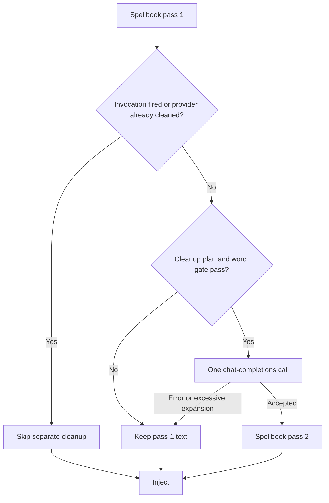

<!-- PAGE_ID: hark_09_voice_cleanup -->

Relevant source files

The following files were used as evidence for this page:

- [crates/hark-voice/src/lib.rs](../../crates/hark-voice/src/lib.rs)
- [crates/hark-voice/src/voices.rs:1-327](../../crates/hark-voice/src/voices.rs#L1-L327)
- [crates/hark-voice/src/openai_compatible.rs:1-338](../../crates/hark-voice/src/openai_compatible.rs#L1-L338)
- [crates/hark-voice/src/error.rs:1-178](../../crates/hark-voice/src/error.rs#L1-L178)
- [crates/hark-voice/src/summary.rs:1-45](../../crates/hark-voice/src/summary.rs#L1-L45)
- [crates/hark-voice/src/speaker_refs.rs](../../crates/hark-voice/src/speaker_refs.rs)
- [crates/hark-voice/src/speaker_names.rs](../../crates/hark-voice/src/speaker_names.rs)
- [crates/hark-pipeline/src/meeting/speakers.rs](../../crates/hark-pipeline/src/meeting/speakers.rs)
- [crates/hark-config/src/voice.rs:1-337](../../crates/hark-config/src/voice.rs#L1-L337)
- [crates/hark-config/src/provider.rs](../../crates/hark-config/src/provider.rs)
- [crates/hark-pipeline/src/plan.rs](../../crates/hark-pipeline/src/plan.rs)
- [crates/hark-pipeline/src/worker.rs](../../crates/hark-pipeline/src/worker.rs)
- [crates/hark-pipeline/src/worker/shape.rs:1-226](../../crates/hark-pipeline/src/worker/shape.rs#L1-L226)
- [crates/hark-pipeline/src/worker/record.rs:1-79](../../crates/hark-pipeline/src/worker/record.rs#L1-L79)
- [crates/hark-pipeline/src/meeting/finish.rs](../../crates/hark-pipeline/src/meeting/finish.rs)
- [crates/hark-stt/src/lib.rs](../../crates/hark-stt/src/lib.rs)
- [crates/hark-stt/src/gemini_live/mode.rs](../../crates/hark-stt/src/gemini_live/mode.rs)

# Voice Cleanup

Meeting notes are an independent post-transcription request. The selected
Deepgram/Gemini final pass does not change the notes provider. An explicit re-run
of a saved recording first bakes the current names into its notes, then guesses
speaker names again and rewrites the notes from the replacement transcript when
notes are on; checked action items carry over. Dictation's Verbatim setting
does not disable new-meeting summaries
([finisher](../../crates/hark-pipeline/src/meeting/finish.rs),
[re-run](../../crates/hark-pipeline/src/meeting/rerun.rs),
[replacement](../../crates/hark-store/src/meetings.rs)).

> **Related Pages**: [Transcription](TRANSCRIPTION.md), [Spellbook](SPELLBOOK.md), [Invocations](INVOCATIONS.md), [Configuration and Secrets](../core/CONFIGURATION.md), [Meetings](MEETINGS.md)

---

<!-- BEGIN:AUTOGEN hark_09_voice_cleanup_overview -->
## Overview

Voice cleanup is Hark's optional rewrite stage between transcription/spellbook processing and text injection. For a resolved non-Verbatim voice, Hark sends one corrected transcript to an OpenAI-compatible chat-completions endpoint; `Voice::Verbatim`, an unresolved provider, short text, an invocation, or an already-cleaned fused transcript makes no separate cleanup call ([lib.rs:1-10](../../crates/hark-voice/src/lib.rs#L1-L10), [worker/shape.rs:23-57](../../crates/hark-pipeline/src/worker/shape.rs#L23-L57)).

Cleanup is deliberately fail-open. There is no retry: any adapter, timeout, parsing, expansion-guard, or provider failure injects the pre-cleanup text instead of losing the dictation or doubling worst-case latency. The timeout is sized to the text: 4 s plus 5 ms per character, capped at 10 s, so a short dictation whose cleanup call hangs falls back to its uncleaned text after about four seconds instead of ten ([lib.rs:38-57](../../crates/hark-voice/src/lib.rs#L38-L57)). The crate uses blocking `reqwest` on the existing pipeline worker, through the process-wide client from `hark-stt` (static Mozilla trust roots, no OS certificate store, 3-second connect bound; [Transcription](TRANSCRIPTION.md)). Only the meeting final pass builds a separate client, with a longer connect bound, so cleanup's latency budget is unaffected by it, and never logs API keys, prompts, spellbook terms, or transcript text ([lib.rs:7-10](../../crates/hark-voice/src/lib.rs#L7-L10), [openai_compatible.rs:197-246](../../crates/hark-voice/src/openai_compatible.rs#L197-L246), [worker/shape.rs:78-155](../../crates/hark-pipeline/src/worker/shape.rs#L78-L155)).

The configured voice and the provider are resolved independently. A non-Verbatim voice may inherit an OpenAI or Gemini STT provider and key, use an explicit cleanup provider/key, or degrade to Verbatim with a startup warning when no chat-capable provider resolves. OpenAI with Live transcribe on still inherits OpenAI cleanup: the realtime model returns a verbatim transcript, and `gpt-5-nano` cleans it on the same key ([voice.rs:246-337](../../crates/hark-config/src/voice.rs#L246-L337)).

Meeting notes reuse this same fail-open shape at a coarser grain: `hark-voice::summarize` calls a chat-completions provider once, after the call ends rather than on the hot path, and returns validated `MeetingNotes` (title, summary, key points, decisions, action items) or an error the meeting keeps its transcript through — never a partial or invented result ([summary.rs:1-12](../../crates/hark-voice/src/summary.rs#L1-L12)). See [Meetings](MEETINGS.md#notes) for where that call fits in a call's lifecycle.

Sources: [crates/hark-voice/src/lib.rs](../../crates/hark-voice/src/lib.rs), [crates/hark-config/src/voice.rs:246-337](../../crates/hark-config/src/voice.rs#L246-L337), [crates/hark-pipeline/src/worker/shape.rs:23-155](../../crates/hark-pipeline/src/worker/shape.rs#L23-L155), [crates/hark-voice/src/summary.rs:1-12](../../crates/hark-voice/src/summary.rs#L1-L12)
<!-- END:AUTOGEN hark_09_voice_cleanup_overview -->

---

<!-- BEGIN:AUTOGEN hark_09_voice_cleanup_voices -->
## Voice Presets

Hark currently recognizes 11 voice names. Parsing is case-insensitive and whitespace-tolerant; configuration and the CLI share the same names ([voices.rs:8-98](../../crates/hark-voice/src/voices.rs#L8-L98)).

| Voice | Intended transformation |
|---|---|
| `verbatim` | No cleanup adapter and no call |
| `grammar` | Correct grammar, spelling, punctuation, and capitalization without rephrasing |
| `clean` | Remove fillers/false starts/repetition while keeping wording and tone |
| `professional` | Polish into a business register |
| `casual` | Keep a relaxed conversational register |
| `notes` | Produce concise first-person work/ticket notes |
| `concise` | Remove repetition and redundancy while preserving facts |
| `direct` | Lead with the point and remove hedging/warm-up phrases |
| `plain` | Use courteous, non-technical wording without adding explanations |
| `pirate` | Novelty pirate diction while retaining facts and length |
| `custom` | Use the user's prompt text as the instruction |

The built-in instructions are defined together so their behavior is explicit and testable ([voices.rs:170-216](../../crates/hark-voice/src/voices.rs#L170-L216)). Every built-in prompt also receives a no-em/en-dash clause and a length-discipline clause; `custom` is the escape hatch and receives neither, because deliberate expansion or formatting may be the user's request. All prompts end with the return-only clause, and present spellbook terms are protected within a bounded 400-token-equivalent budget ([voices.rs:110-168](../../crates/hark-voice/src/voices.rs#L110-L168), [voices.rs:289-326](../../crates/hark-voice/src/voices.rs#L289-L326)).

The default settings are `clean`, skip below five words, and reject built-in output above a 1.4x ratio (with three words of absolute slack); zero disables either gate. The post-response expansion guard does not apply to `custom` ([voice.rs:49-84](../../crates/hark-config/src/voice.rs#L49-L84), [voices.rs:218-240](../../crates/hark-voice/src/voices.rs#L218-L240)).

Sources: [crates/hark-voice/src/voices.rs:8-120](../../crates/hark-voice/src/voices.rs#L8-L120), [crates/hark-voice/src/voices.rs:145-326](../../crates/hark-voice/src/voices.rs#L145-L326), [crates/hark-config/src/voice.rs:49-84](../../crates/hark-config/src/voice.rs#L49-L84)
<!-- END:AUTOGEN hark_09_voice_cleanup_voices -->

---

<!-- BEGIN:AUTOGEN hark_09_voice_cleanup_adapter -->
## Cleanup Adapter

`OpenAiCompatibleChat` is the live cleanup adapter. It sends buffered JSON to `POST {base_url}/chat/completions` with Bearer authentication and the process-wide blocking HTTP client. The same contract serves OpenAI, Gemini's OpenAI-compatible endpoint, and user-supplied compatible endpoints; Deepgram has no chat product and is rejected by configuration validation. Groq is no longer a cleanup preset: schema 7 rewrites a saved Groq cleanup provider, explicit or inherited, as an `openai-compatible` table with Groq's URL, `llama-3.1-8b-instant` and temperature 0.2 ([openai_compatible.rs:1-18](../../crates/hark-voice/src/openai_compatible.rs#L1-L18), [voice.rs:87-158](../../crates/hark-config/src/voice.rs#L87-L158), [voice.rs:189-221](../../crates/hark-config/src/voice.rs#L189-L221), [groq_migration.rs](../../crates/hark-config/src/groq_migration.rs), [Configuration](../core/CONFIGURATION.md#groq-retirement-schema-7)).

The provider resolver supports these paths:

| Configuration | Result |
|---|---|
| Verbatim voice | No provider or key is needed |
| Explicit `[voice.provider]` | Uses the configured kind/base URL/model and a cleanup account key |
| OpenAI (batch or Live transcribe) or Gemini STT with no override | Inherits the provider and already-resolved STT key; Gemini defaults to its `/v1beta/openai` chat URL and `gemini-3.5-flash-lite` model |
| Deepgram or generic OpenAI-compatible STT with no override | Degrades to Verbatim with a warning because STT support does not prove a chat endpoint exists |

The resolution rules and presets live in `hark-config`, while pipeline construction performs key lookup, builds the adapter, and converts every missing-key/build failure into `None` so STT still starts ([voice.rs:115-187](../../crates/hark-config/src/voice.rs#L115-L187), [voice.rs:223-337](../../crates/hark-config/src/voice.rs#L223-L337), [`build_cleanup` in pipeline plan.rs:77-159](../../crates/hark-pipeline/src/plan.rs#L77-L159)).

Meeting notes resolve the same way, through the same `resolve_cleanup_provider`, but ask for it as if a non-Verbatim voice were selected — a `Verbatim` dictation setup still has a text provider that can write notes, since the summary call is independent of the dictation cleanup voice. `notes_provider` is the one resolver: the notes, the notes rewrite after moved lines, and speaker-name guessing all use it, so they reach the same provider under the same consent ([speakers.rs:51-77](../../crates/hark-pipeline/src/meeting/speakers.rs#L51-L77)).

Each request builds a system prompt from the effective voice and terms present in that transcript, sends the transcript fenced in `<transcript>` tags, and opens the system prompt with `TRANSCRIPT_IS_DATA_CLAUSE`, which tells the model the fenced text is dictation to edit, never a request to answer. Without it, dictation that sounds like an instruction ("Proceed however you recommend...") was answered instead of edited. The adapter also strips an echoed fence from the response. It derives `max_completion_tokens` from input length with a 512-to-4096 clamp, and never retries ([openai_compatible.rs:20-182](../../crates/hark-voice/src/openai_compatible.rs#L20-L182), [openai_compatible.rs:287-333](../../crates/hark-voice/src/openai_compatible.rs#L287-L333)). `CleanupConfig` has a manual `Debug` implementation that redacts the API key and custom prompt and reports only the spellbook-term count ([openai_compatible.rs:197-241](../../crates/hark-voice/src/openai_compatible.rs#L197-L241)).

**The request timeout scales with the input.** `cleanup_timeout_ms` allows 4 s (`CLEANUP_TIMEOUT_FLOOR_MS`) plus 5 ms per input character, capped at the 10 s `CLEANUP_TIMEOUT_MS`:

| Input | Timeout |
|---|---|
| 1 character | 4.005 s |
| 200 characters | 5 s |
| 1,200 characters or more | 10 s |

The floor is not lower because LLM latency has a fat tail. The number is computed per request from the text being cleaned, set on the request with `RequestBuilder::timeout`, and passed to the error mapping, so a timeout error names the bound that was actually in force. The connect bound is still the shared client's 3 s ([lib.rs:33-57](../../crates/hark-voice/src/lib.rs#L33-L57), [openai_compatible.rs:302-312](../../crates/hark-voice/src/openai_compatible.rs#L302-L312), test `cleanup_timeout_scales_with_input_between_floor_and_cap` at [lib.rs:82-91](../../crates/hark-voice/src/lib.rs#L82-L91)).

Sources: [crates/hark-voice/src/openai_compatible.rs:1-338](../../crates/hark-voice/src/openai_compatible.rs#L1-L338), [crates/hark-voice/src/lib.rs:33-57](../../crates/hark-voice/src/lib.rs#L33-L57), [crates/hark-config/src/voice.rs:87-187](../../crates/hark-config/src/voice.rs#L87-L187), [crates/hark-config/src/voice.rs:223-337](../../crates/hark-config/src/voice.rs#L223-L337), [crates/hark-pipeline/src/plan.rs:77-159](../../crates/hark-pipeline/src/plan.rs#L77-L159), [crates/hark-pipeline/src/meeting/finish.rs](../../crates/hark-pipeline/src/meeting/finish.rs)
Nonempty content is rejected when `finish_reason` is `length`, `content_filter`,
`tool_calls`, or `function_call`: a returned prefix is not a complete cleanup.
The existing fail-open path keeps the original transcript. Compatible endpoints
that omit the reason remain supported, and error messages include only trusted
reason labels, never response text
([parser](../../crates/hark-voice/src/openai_compatible.rs),
[regressions](../../crates/hark-voice/tests/chat_pure.rs)).
<!-- END:AUTOGEN hark_09_voice_cleanup_adapter -->

---

<!-- BEGIN:AUTOGEN hark_09_voice_cleanup_pipeline -->
## Pipeline Behavior

After a non-empty transcription, the worker applies spellbook pass 1 and then checks invocations. A fired invocation is user-authored canned text, so it skips cleanup and the second spellbook pass entirely. A fused provider result also skips the separate cleanup call, preventing a second rewrite and bill ([worker/shape.rs:23-57](../../crates/hark-pipeline/src/worker/shape.rs#L23-L57), [`should_run_cleanup`, worker/shape.rs:68-76](../../crates/hark-pipeline/src/worker/shape.rs#L68-L76)). These text steps are one function, `shape_transcript`, shared by a live dictation and a retry of a held clip from History, so a recovered dictation gets exactly the same spellbook, invocation and cleanup treatment ([worker/held.rs:108-110](../../crates/hark-pipeline/src/worker/held.rs#L108-L110)).

For an ordinary transcript with a cleanup plan:

1. Text below `skip_below_words` passes through unchanged.
2. The adapter performs one rewrite request.
3. A built-in voice response beyond `max_expansion_ratio` plus the three-word grace is rejected; `custom` is exempt.
4. A built-in voice response that reads as a reply rather than an edit is rejected by `reads_as_reply`. It uses the prompt's own vocabulary ("transcript", "rewrite") that the speaker never said, or it keeps none of the speaker's words of four or more letters when the input has at least three. `custom` is exempt, because a translation prompt keeps no words.
5. An accepted response goes through spellbook pass 2 to repair any protected term the model still changed.
6. Any error returns pass-1 text with no cleanup timing/model attribution.

This control flow is implemented in `cleaned_text` and keeps history honest: cleanup metadata appears only when its response actually shaped the injected text ([worker/shape.rs:59-155](../../crates/hark-pipeline/src/worker/shape.rs#L59-L155), [worker/record.rs:49-61](../../crates/hark-pipeline/src/worker/record.rs#L49-L61)). The same record is what a failed paste hands to History (`NotPasted`), so a cleaned dictation that could not be pasted keeps its cleanup attribution ([worker.rs:572-610](../../crates/hark-pipeline/src/worker.rs#L572-L610)).

Gemini Live has a distinct fused `smart` mode. In that mode the single returned string is put in both `Transcript.text` and `Transcript.cleaned`; the marker tells the worker to skip Hark's separate voice call. This reduces one round trip but cannot preserve a guaranteed verbatim transcript, which is why the configured default remains `verbatim` ([hark-stt lib.rs:73-87](../../crates/hark-stt/src/lib.rs#L73-L87), [gemini_live/mode.rs:101-122](../../crates/hark-stt/src/gemini_live/mode.rs#L101-L122), [hark-config provider.rs:75-92](../../crates/hark-config/src/provider.rs#L75-L92)). History labels that result as voice `smart` and attributes the STT model as the cleanup model; ordinary skipped/failed cleanup is labeled `verbatim` with no cleanup model ([worker/record.rs:49-61](../../crates/hark-pipeline/src/worker/record.rs#L49-L61)). Because the voice never runs in Smart, choosing the Verbatim voice does not stop Smart rewriting text; the Voice picker says so whenever Smart is in effect, and the expanded History row heads that text "GEMINI SMART TEXT · NOT VERBATIM" rather than "RAW TRANSCRIPT" ([form.rs:392-409](../../crates/hark-app/src/ui/settings/form.rs#L392-L409), [row.rs:290-296](../../crates/hark-app/src/ui/history/row.rs#L290-L296)). A Smart turn that comes back as Gemini's canned refusal is replayed in Verbatim, and that replay does run the voice ([gemini_live/mode.rs:49-99](../../crates/hark-stt/src/gemini_live/mode.rs#L49-L99)). The STT time History shows for a fused Smart turn is the wait after release only, which already includes Gemini's formatting, so it is not comparable with a Verbatim row's STT time plus a separate cleanup call ([hark-stt lib.rs:73-76](../../crates/hark-stt/src/lib.rs#L73-L76), [gemini_live/mode.rs:101-122](../../crates/hark-stt/src/gemini_live/mode.rs#L101-L122)).

Meeting mode never sees Gemini Live's fused `smart` result: the live transcriber uses the ordinary batch `SttProvider::transcribe` path per chunk (or the on-device engine), never the streaming session, so a meeting line always goes through the spellbook corrector as text, with no fused-cleanup shortcut to skip ([live.rs:272-306](../../crates/hark-pipeline/src/meeting/live.rs#L272-L306)).

The schema-6 meeting echo setting controls an earlier audio stage: it filters the
microphone before recording and STT. Meeting notes still use the independent
summary setting and text-provider request after transcription
([echo processing](MEETINGS.md#reduce-speaker-echo),
[configuration](../../crates/hark-config/src/meeting.rs)).

Sources: [crates/hark-pipeline/src/worker/shape.rs:23-155](../../crates/hark-pipeline/src/worker/shape.rs#L23-L155), [crates/hark-pipeline/src/worker/record.rs:24-79](../../crates/hark-pipeline/src/worker/record.rs#L24-L79), [crates/hark-stt/src/gemini_live/mode.rs](../../crates/hark-stt/src/gemini_live/mode.rs), [crates/hark-config/src/provider.rs:75-92](../../crates/hark-config/src/provider.rs#L75-L92), [crates/hark-pipeline/src/meeting/live.rs:272-306](../../crates/hark-pipeline/src/meeting/live.rs#L272-L306)
Insights reports usage by the configured voice and completion latency, alongside measured local Spellbook replacement counts. It does not infer how many edits the cleanup provider made or assign an accuracy score. Replacement counts include the second Spellbook pass only when that pass runs; the fired-invocation branch still bypasses cleanup and later rewriting. All numeric persistence follows insertion ([worker/shape.rs:143-148](../../crates/hark-pipeline/src/worker/shape.rs#L143-L148), [worker/record.rs:74-76](../../crates/hark-pipeline/src/worker/record.rs#L74-L76), [Insights aggregation](../../crates/hark-store/src/insights/query.rs)).
<!-- END:AUTOGEN hark_09_voice_cleanup_pipeline -->

---

<!-- BEGIN:AUTOGEN hark_09_voice_cleanup_api -->
## Public API

The crate root keeps the reusable behavior small and provider-neutral ([lib.rs](../../crates/hark-voice/src/lib.rs)).

| Item | Contract |
|---|---|
| `CleanupProvider` | Blocking, `Send` trait with `clean(text)` and a safe provider label; pipeline tests can replace it with a scripted cleaner |
| `Cleaned` | Accepted text plus full request wall time |
| `Voice` / `UnknownVoice` | Runtime voice enum and parsing error with the valid names |
| `system_prompt` / `present_terms` | Pure per-request prompt assembly and protected-term filtering |
| `skips_cleanup` / `over_expanded` / `reads_as_reply` | Pure pre-request and post-response gates |
| `CleanupError` / mapping helpers | Log-safe error taxonomy and pure status/transport classification |
| `CONNECT_TIMEOUT_MS` | The shared client's 3-second connection bound, mirrored so error mapping can name it |
| `cleanup_timeout_ms` / `CLEANUP_TIMEOUT_FLOOR_MS` / `CLEANUP_TIMEOUT_MS` | The per-request timeout for an input of a given length: a 4-second floor plus 5 ms per character, up to the 10-second ceiling |
| `summarize` / `MeetingNotes` / `SummaryConfig` | Meeting-only: one long-context call over a full transcript, validated into structured notes; `SUMMARY_TIMEOUT_MS` is 120 s, not the dictation `CLEANUP_TIMEOUT_MS` ([summary.rs:38](../../crates/hark-voice/src/summary.rs#L38)). `summarize` and `parse_notes` take the call's `(default label, key)` table: an always-appended `SPEAKER_REF_CLAUSE` asks for braced labels (`{Speaker 2}`), and parsing turns each into a `{{key}}` token ([summary.rs:54-62](../../crates/hark-voice/src/summary.rs#L54-L62), [summary.rs:431](../../crates/hark-voice/src/summary.rs#L431)) |
| `MeetingNotes::render` / `bake` / `carry_done_from` | Deterministic, no call: `render` writes the roster's names over tokens (and, for notes stored before tokens, over whole default labels) and marks the copy `frozen`; `bake` is the stored form of that; `carry_done_from` keeps ticked action items across a rewrite (word-set Jaccard >= 0.6) ([summary.rs:113-175](../../crates/hark-voice/src/summary.rs#L113-L175)) |
| `SpeakerRefs` / `speaker_spans` | `tokens`, `labels` (the serde default) or `frozen` (also any unknown value); `speaker_spans` splits a field into plain text and speaker names with exactly `render`'s text, for colored names ([speaker_refs.rs:13-105](../../crates/hark-voice/src/speaker_refs.rs#L13-L105)) |
| `guess_speaker_names` / `build_guess_request` / `parse_guesses` | Meeting-only: one JSON call that names speakers from the transcript, given numbered lines with default labels only and the labels that may be named; 60 s (`GUESS_TIMEOUT_MS`); a cut-off list is salvaged; the caller validates every guess ([speaker_names.rs:1-60](../../crates/hark-voice/src/speaker_names.rs#L1-L60), [speaker_names.rs:197](../../crates/hark-voice/src/speaker_names.rs#L197)) |

The concrete `CleanupConfig` and `OpenAiCompatibleChat` stay in the public `openai_compatible` module rather than being re-exported from the root. Construction rejects `Verbatim`, because reaching the adapter for a voice that promises no call is a caller bug handled by the pipeline's fail-open build path ([openai_compatible.rs:197-285](../../crates/hark-voice/src/openai_compatible.rs#L197-L285)). `summary` follows the same discipline in reverse: it reuses `openai_compatible`'s URL-building, response-parsing, and status/transport error mapping rather than duplicating them, so only the notes-specific prompt, JSON schema, and validation are new code ([summary.rs:6-12](../../crates/hark-voice/src/summary.rs#L6-L12)).

Sources: [crates/hark-voice/src/lib.rs](../../crates/hark-voice/src/lib.rs), [crates/hark-voice/src/openai_compatible.rs:197-285](../../crates/hark-voice/src/openai_compatible.rs#L197-L285), [crates/hark-voice/src/summary.rs:1-45](../../crates/hark-voice/src/summary.rs#L1-L45), [crates/hark-voice/src/speaker_refs.rs](../../crates/hark-voice/src/speaker_refs.rs), [crates/hark-voice/src/speaker_names.rs](../../crates/hark-voice/src/speaker_names.rs)
<!-- END:AUTOGEN hark_09_voice_cleanup_api -->

---

<!-- BEGIN:AUTOGEN hark_09_voice_cleanup_errors -->
## Error Handling

`CleanupError` intentionally mirrors the STT error categories while remaining a separate small enum. Adapter diagnostics contain only trusted labels, status codes, and structural information: no API key, Authorization header, prompt, spellbook term, transcript text, or provider response body ([error.rs](../../crates/hark-voice/src/error.rs)).

| Variant | Trigger and sanitization |
|---|---|
| `Http` | Fixed transport category; the underlying error string and request URL are never included |
| `Auth` | HTTP 401/403 plus an allowlisted `error.code`/`error.type`, if recognized; unknown values and prose are omitted |
| `RateLimited` | HTTP 429, with optional seconds-form `Retry-After` |
| `Timeout` | Connect or request timeout, reporting the bound actually hit |
| `Provider` | HTTP status, a fixed failure category, or JSON error category with numeric line/column; no response snippets |

Even a short machine-readable field can contain user text, so authentication reasons must match a fixed allowlist such as `invalid_api_key` or `insufficient_quota`. A 401 adds “check your API key” only when no recognized reason exists; a 403 does not add that hint. Transport mapping distinguishes the shared 3-second connect timeout from the request timeout without formatting the underlying error. The request timeout it reports is the one computed for that input by `cleanup_timeout_ms`, between 4 and 10 seconds, not a fixed 10 ([error.rs](../../crates/hark-voice/src/error.rs), [openai_compatible.rs:302-318](../../crates/hark-voice/src/openai_compatible.rs#L302-L318)).

Successful HTTP status is not sufficient: parsing requires a non-empty `choices[0].message.content`. Missing/empty content becomes `Provider`, retaining only an allowlisted `finish_reason` such as `length`; arbitrary values become `unknown`. JSON parser errors expose the category and numeric line/column because the parser's full error string can quote an offending transcript value. This rule also covers meeting-summary responses and stored notes JSON. Ordinary cleanup failures keep the uncleaned transcript and record no cleanup attribution ([response parser](../../crates/hark-voice/src/openai_compatible.rs), [summary parser](../../crates/hark-voice/src/summary.rs), [pipeline, worker/shape.rs:150-153](../../crates/hark-pipeline/src/worker/shape.rs#L150-L153)).

Sources: [error mapping](../../crates/hark-voice/src/error.rs), [response parsing](../../crates/hark-voice/src/openai_compatible.rs), [summary parsing](../../crates/hark-voice/src/summary.rs), [privacy regression tests](../../crates/hark-voice/tests/error_privacy.rs)
<!-- END:AUTOGEN hark_09_voice_cleanup_errors -->

---
