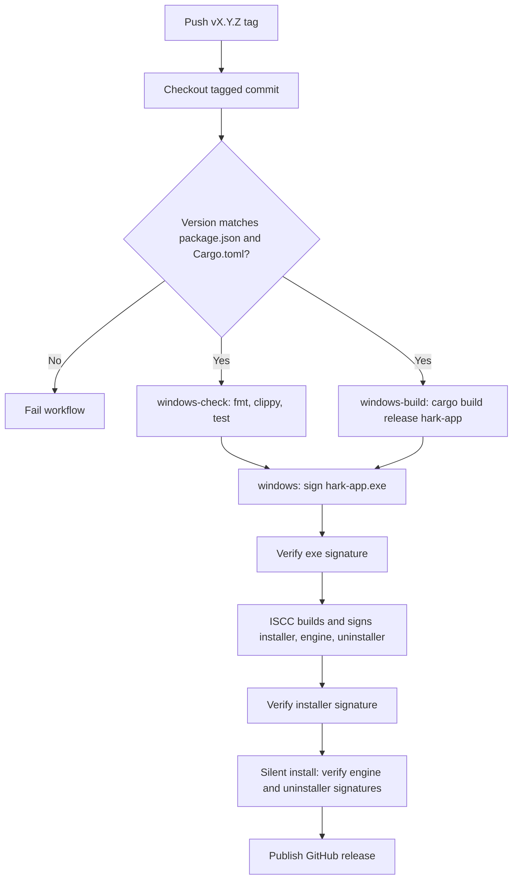

<!-- PAGE_ID: hark_13_release_packaging -->
<details>
<summary>Relevant source files</summary>

The following files were used as evidence for this page:

- [installer/hark.iss:1-96](https://github.com/BoardPandas/Hark/blob/1c1738716fa4cd758b0c26ec94d0873d1bc35ac1/installer/hark.iss#L1-L96)
- [.github/workflows/release.yml:1-223](https://github.com/BoardPandas/Hark/blob/1c1738716fa4cd758b0c26ec94d0873d1bc35ac1/.github/workflows/release.yml#L1-L223)
- [.github/RELEASING.md:1-77](https://github.com/BoardPandas/Hark/blob/1c1738716fa4cd758b0c26ec94d0873d1bc35ac1/.github/RELEASING.md#L1-L77)
- [package.json:1-7](https://github.com/BoardPandas/Hark/blob/1c1738716fa4cd758b0c26ec94d0873d1bc35ac1/package.json#L1-L7)
- [Cargo.toml:1-29](https://github.com/BoardPandas/Hark/blob/1c1738716fa4cd758b0c26ec94d0873d1bc35ac1/Cargo.toml#L1-L29)
- [installer/hark.iss:36-65](https://github.com/BoardPandas/Hark/blob/1c1738716fa4cd758b0c26ec94d0873d1bc35ac1/installer/hark.iss#L36-L65)
- [.github/workflows/release.yml:54-76](https://github.com/BoardPandas/Hark/blob/1c1738716fa4cd758b0c26ec94d0873d1bc35ac1/.github/workflows/release.yml#L54-L76)
- [.github/workflows/release.yml:126-140](https://github.com/BoardPandas/Hark/blob/1c1738716fa4cd758b0c26ec94d0873d1bc35ac1/.github/workflows/release.yml#L126-L140)
- [.github/workflows/ci.yml](../../.github/workflows/ci.yml)

</details>

# Release and Packaging

> **Related Pages**: [Getting Started](../GETTING_STARTED.md), [Updates and Autostart](../features/UPDATES_AND_AUTOSTART.md), [Overview](../OVERVIEW.md), [Meetings](../features/MEETINGS.md)

---

<!-- BEGIN:AUTOGEN hark_13_release_packaging_overview -->
## Overview

Cutting a Hark release means pushing a `vMAJOR.MINOR.PATCH` tag; everything after that (build, sign, verify, package, publish) is automated by GitHub Actions ([release.yml:105-1258](../../.github/workflows/release.yml#L105-L1258)). A `version` gate verifies the tag, and a `release` job creates the release object once every platform's checks have passed ([release.yml:186-218](../../.github/workflows/release.yml#L186-L218)). Meanwhile Windows, macOS (Apple Silicon only), Linux and Arch each run as a check job, a build job and a final job that `needs` both, and only that final job signs and appends assets ([release.yml:20-55](../../.github/workflows/release.yml#L20-L55)). On Windows, `windows-check` runs fmt, clippy and the tests while `windows-build` compiles `hark-app`. `windows` then signs the binary with Azure Trusted Signing, packages it into a per-user Inno Setup installer, signs that installer too, and verifies both signatures ([release.yml:220-601](../../.github/workflows/release.yml#L220-L601)).

Cut a tag only after the CI matrix is green: v0.60.0 and v0.60.1 were tagged on a tree whose Windows/macOS legs failed to compile, and both asset-less releases and tags had to be deleted and re-cut — the version gate cannot catch platform breaks a Linux-only author never builds. The trigger is either a pushed tag matching `v*` or a manual `workflow_dispatch` run against an existing tag ([release.yml:68-81](../../.github/workflows/release.yml#L68-L81)). A `concurrency` group keyed on the tag prevents two runs from racing on the same release, with `cancel-in-progress: false` so a second tag never cancels a build already under way ([release.yml:101-103](../../.github/workflows/release.yml#L101-L103)).



The installer (`Hark-<version>-windows-x64-setup.exe`) is the only Windows asset attached to the release ([release.yml:586-601](../../.github/workflows/release.yml#L586-L601)). A renamed copy of the raw binary used to ship beside it as a portable download and no longer does: it was a second artifact of the same binary that produced an install Windows had no record of, and it was also what the in-app updater self-replaced with ([release.yml:579-585](../../.github/workflows/release.yml#L579-L585)). Release notes are auto-generated by the `release` job when it creates the release, so the publish jobs append assets only ([release.yml:186-218](../../.github/workflows/release.yml#L186-L218)).

Sources: [release.yml:68-103](../../.github/workflows/release.yml#L68-L103), [release.yml:105-601](../../.github/workflows/release.yml#L105-L601), [RELEASING.md:1-30](../../.github/RELEASING.md#L1-L30)
The native Home/Insights design embeds static Lora Regular alongside the existing interface/icon fonts. Its unmodified upstream font and SIL OFL 1.1 license live in `crates/hark-app/assets`; the full copyright/license is also included in shipped `THIRD_PARTY_NOTICES.md`. Font loading makes no runtime network request ([asset provenance](../../crates/hark-app/assets/README.md), [third-party notices](../../THIRD_PARTY_NOTICES.md)).
<!-- END:AUTOGEN hark_13_release_packaging_overview -->

---

<!-- BEGIN:AUTOGEN hark_13_release_packaging_installer -->
## Windows Installer

The installer is defined by an Inno Setup 6 script that CI invokes with `/DAppVersion=<x.y.z> /DSourceExe=<path to signed hark-app.exe>` (`installer/hark.iss:15-19`). It intentionally installs per-user with no elevation.

| Setting | Value | Why |
|---|---|---|
| `PrivilegesRequired` | `lowest` | No admin/UAC prompt; makes `{autopf}` resolve to `%LOCALAPPDATA%\Programs\Hark` instead of Program Files ([hark.iss:45-49](https://github.com/BoardPandas/Hark/blob/1c1738716fa4cd758b0c26ec94d0873d1bc35ac1/installer/hark.iss#L45-L49)) |
| `AppId` | fixed GUID `8F2A6C31-...` | Keys upgrades and uninstall; must **never** change ([hark.iss:37-38](https://github.com/BoardPandas/Hark/blob/1c1738716fa4cd758b0c26ec94d0873d1bc35ac1/installer/hark.iss#L37-L38)) |
| `ArchitecturesAllowed` / `ArchitecturesInstallIn64BitMode` | `x64compatible` | The exe is x64 only; refuses 32-bit Windows ([hark.iss:50-52](https://github.com/BoardPandas/Hark/blob/1c1738716fa4cd758b0c26ec94d0873d1bc35ac1/installer/hark.iss#L50-L52)) |
| `OutputBaseFilename` | `Hark-{#AppVersion}-windows-x64-setup` | Produces `installer\Output\Hark-<ver>-windows-x64-setup.exe` ([hark.iss:53-54](https://github.com/BoardPandas/Hark/blob/1c1738716fa4cd758b0c26ec94d0873d1bc35ac1/installer/hark.iss#L53-L54)) |
| `CloseApplications` / `RestartApplications` | `yes` / `no` | An autostarted Hark may be running during upgrade; Restart Manager closes it so the exe can be replaced, and it relaunches via `[Run]` or at next login instead of being force-restarted ([hark.iss:60-64](https://github.com/BoardPandas/Hark/blob/1c1738716fa4cd758b0c26ec94d0873d1bc35ac1/installer/hark.iss#L60-L64)) |

Installed files, shortcuts, and the autostart registry seed are declared in dedicated sections:

```ini
[Files]
Source: "{#SourceExe}"; DestDir: "{app}"; DestName: "{#AppExeName}"; Flags: ignoreversion
; LAME (LGPL) is linked into the exe for meeting MP3s; its notice ships beside it.
Source: "..\THIRD_PARTY_NOTICES.md"; DestDir: "{app}"; Flags: ignoreversion

[Icons]
Name: "{group}\{#AppName}"; Filename: "{app}\{#AppExeName}"
Name: "{group}\Uninstall {#AppName}"; Filename: "{uninstallexe}"
Name: "{autodesktop}\{#AppName}"; Filename: "{app}\{#AppExeName}"; Tasks: desktopicon

[Registry]
Root: HKCU; Subkey: "Software\Microsoft\Windows\CurrentVersion\Run"; \
    ValueType: string; ValueName: "{#RunValueName}"; \
    ValueData: """{app}\{#AppExeName}"" --hidden"; \
    Flags: uninstalldeletevalue
```

Sources: [hark.iss:73-90](../../installer/hark.iss#L73-L90)

Meeting mode encodes recordings to MP3 with LAME through `mp3lame-encoder`/`mp3lame-sys`; LAME is LGPL-2.0+ and statically linked. The installer ships `THIRD_PARTY_NOTICES.md` beside the exe. That notice describes the LAME relink right and also reproduces the selected `aec3 0.4.0` package's complete LICENSE and PATENT files: MIT terms for its new Rust contributions, BSD terms for WebRTC-derived portions, and the accompanying Google patent grant. The package's `MIT OR BSD-3-Clause` manifest shorthand does not replace these component notices ([installer](../../installer/hark.iss), [notices](../../THIRD_PARTY_NOTICES.md)).

The same notice accompanies every binary package:

| Package | Notice location |
| --- | --- |
| Windows installer | `{app}/THIRD_PARTY_NOTICES.md`, beside `hark-app.exe` |
| Debian / RPM | `/usr/share/doc/hark/THIRD_PARTY_NOTICES.md` |
| Arch | `/usr/share/licenses/hark/THIRD_PARTY_NOTICES.md` |
| Linux tarball | Archive root beside `LICENSE` and `README.md` |

Linux release checks inspect each built package's notice entry before publishing.
The manifest, PKGBUILD, and tarball staging each include the file explicitly;
keeping it only in the Git repository would not include it in those binaries'
distribution materials ([package assets](../../crates/hark-app/Cargo.toml),
[Arch package](../../packaging/PKGBUILD), [release checks](../../.github/workflows/release.yml)).

The `[Registry]` entry seeds launch-at-login so it works immediately after a fresh install, mirroring the exact format `hark-autostart` writes at runtime (quoted path plus `--hidden`), and `uninstalldeletevalue` removes it on uninstall so the value can never point at a deleted exe (`installer/hark.iss:83-90`). The desktop shortcut is opt-in via the `desktopicon` task, unchecked by default (`installer/hark.iss:70-71`). The `[Run]` step deliberately omits `--hidden` so a fresh install's first launch shows the onboarding window (no STT key configured yet), while `skipifsilent` keeps unattended installs headless (`installer/hark.iss:92-97`). User data at `%APPDATA%\hark` (`config.toml` + `history.db`) is intentionally left in place on uninstall (`installer/hark.iss:12-13`); meeting recordings under that same directory's `meetings/` folder are left in place too, since nothing about uninstall is meeting-aware.

Sources: [hark.iss:1-98](../../installer/hark.iss#L1-L98), [THIRD_PARTY_NOTICES.md](../../THIRD_PARTY_NOTICES.md)
<!-- END:AUTOGEN hark_13_release_packaging_installer -->

---

<!-- BEGIN:AUTOGEN hark_13_release_packaging_workflow -->
## Release Workflow

Ordinary pushes and pull requests run the separate CI workflow before release: Claude wiring, documentation source-map drift, formatting, dependency audit, and the multi-platform Rust matrix. The documentation job fetches full history and runs `npm run check:docs`; this enforces source/page co-change, but does not claim the prose is semantically complete ([ci.yml:1-102](../../.github/workflows/ci.yml#L1-L102)). Since 0.61.7 the wiring job, on both Ubuntu and Windows, also runs `scripts/commit-hooks.test.mjs`: it builds a throwaway repository with a worktree and asserts the `git commit` hooks judge the repository the commit lands in (the payload's `cwd`, a `cd DIR &&`, or `git -C DIR`), not the main checkout the hook process starts in ([ci.yml:45-68](../../.github/workflows/ci.yml#L45-L68)).

The workflow's default permission is `contents: read`. Only `release` and the four publish jobs get `contents: write`, and none of them runs cargo, so no job that compiles code holds a token that can publish ([release.yml:83-93](../../.github/workflows/release.yml#L83-L93)). The `version` gate runs first on `ubuntu-latest`; every other job hangs off it, and the publish jobs only ever append ([release.yml:106-184](../../.github/workflows/release.yml#L106-L184)).

| Job | Runner | Needs | Does |
|---|---|---|---|
| `version` | `ubuntu-latest` | | Verifies the tag and runs the `.claude` wiring guard ([release.yml:106-184](../../.github/workflows/release.yml#L106-L184)) |
| `windows-check` | `windows-latest` | `version` | fmt, clippy, tests on the Windows cfg ([release.yml:220-309](../../.github/workflows/release.yml#L220-L309)) |
| `windows-build` | `windows-latest` | `version` | Clean release build; uploads `hark-app.exe` as an artifact ([release.yml:311-342](../../.github/workflows/release.yml#L311-L342)) |
| `windows` | `windows-latest` | `windows-check`, `windows-build` | Signs, packages and attaches the installer ([release.yml:344-601](../../.github/workflows/release.yml#L344-L601)) |
| `linux-check` | `ubuntu-latest` | `version` | fmt, clippy, tests on the Linux cfg ([release.yml:603-674](../../.github/workflows/release.yml#L603-L674)) |
| `linux-build` | `ubuntu-latest` | `version` | Clean release build, `.deb`, `.rpm`, `.tar.gz` and their gates ([release.yml:676-838](../../.github/workflows/release.yml#L676-L838)) |
| `linux` | `ubuntu-latest` | `linux-check`, `linux-build` | Attaches the three Linux assets ([release.yml:839-909](../../.github/workflows/release.yml#L839-L909)) |
| `arch-build` | Arch container | `version` | `makepkg --nocheck` and the package gate ([release.yml:911-1057](../../.github/workflows/release.yml#L911-L1057)) |
| `arch` | `ubuntu-latest` | `linux-check`, `arch-build` | Attaches `.pkg.tar.zst` ([release.yml:1059-1112](../../.github/workflows/release.yml#L1059-L1112)) |
| `macos-check` | `macos-15` | `version` | fmt, clippy, tests on the macOS cfg ([release.yml:1114-1153](../../.github/workflows/release.yml#L1114-L1153)) |
| `macos-build` | `macos-15` | `version` | Clean release build; uploads the binary ([release.yml:1155-1180](../../.github/workflows/release.yml#L1155-L1180)) |
| `macos` | `macos-15` | `macos-check`, `macos-build` | Signs, notarizes, staples and attaches the DMG ([release.yml:1182-1258](../../.github/workflows/release.yml#L1182-L1258)) |
| `release` | `ubuntu-latest` | `version`, `windows-check`, `linux-check`, `macos-check` | Creates the release object and its notes; every publish job needs it ([release.yml:186-218](../../.github/workflows/release.yml#L186-L218)) |

Every publish job also needs `version`, for its outputs, and `release`, so it never appends to a release that does not exist yet. Because `release` needs all three check jobs, a tag that fails any check publishes nothing: no empty release for the in-app updater to offer. Until 0.68.9, `version` created the release before anything was checked ([release.yml:186-218](../../.github/workflows/release.yml#L186-L218)). The checks run beside the builds, not ahead of them, and the gate still holds: a publish job cannot start until its check job passes, so a tree that fails the checks never reaches signing. Arch's `--nocheck` build is justified by `arch` needing `linux-check`. The Arch build starts with everything else, and only its upload waits for the ubuntu suite ([release.yml:918-925](../../.github/workflows/release.yml#L918-L925)).

Since 0.68.9 the check jobs restore the cache ci.yml's `rust` job saves on main, through a shared `rust-checks` key, and never save one. A tag run can read main's caches but not another tag's, so before this every release job logged "No cache found." and compiled from zero. Each still saved about 4.7 GB per release, which no later run could read and which evicted main's caches. The build jobs stay cache-free on purpose: anything that runs on main can write main's cache, and the signed binaries should not depend on it. Releases used to take 28–33 minutes, with Linux then Arch as the longest path. Now the longest path is roughly one clean Windows release build plus signing ([release.yml:272-289](../../.github/workflows/release.yml#L272-L289), [ci.yml](../../.github/workflows/ci.yml)). `linux-build` installs `cargo-deb` from its upstream `.deb`, pinned by version and sha256. `cargo-generate-rpm` publishes no binaries, so it still compiles, at a pinned version ([release.yml:715-739](../../.github/workflows/release.yml#L715-L739)).

The Linux builds link `libpipewire-0.3` (meeting mode's system-audio capture and detection, [Audio Capture](../features/AUDIO_CAPTURE.md#meeting-capture)); the build jobs install `libpipewire-0.3-dev`, whose bindgen step also uses the already-present clang. The `.deb` and `.rpm` infer that soname from the binary the same way they infer ALSA and GTK, and the packaging gates assert it alongside them; the PKGBUILD names `pipewire` in `depends` and `libpipewire` (Arch's package for the headers and `.pc`) in `makedepends` for the same reason ([release.yml:630-640](../../.github/workflows/release.yml#L630-L640), [PKGBUILD](../../packaging/PKGBUILD)). Since 0.61.5 nothing links `libxdo`: muda 0.21 (via tray-icon 0.26) dropped it, so `libxdo-dev` left the CI and release build packages, `xdotool` left the Arch build container and PKGBUILD `depends`, and the Arch package gate no longer requires it (verified with `objdump -p` on `hark-app`: NEEDED lists GTK/GLib, ALSA, PipeWire and the C/C++ runtimes only). Every workflow that sets up Node uses Node 26 (the current LTS) and the v7 `actions/checkout`/`actions/setup-node` pins ([ci.yml](../../.github/workflows/ci.yml), [release.yml](../../.github/workflows/release.yml), [PKGBUILD](../../packaging/PKGBUILD)). The PipeWire Rust bindings and x11rb are MIT-licensed; the notices page records them with LAME and the AEC port ([THIRD_PARTY_NOTICES.md](../../THIRD_PARTY_NOTICES.md)).

Both Ubuntu CI and release runners also install `libpipewire-0.3-modules`
explicitly. The isolated discovery timeout/disconnect test loads
`libpipewire-module-protocol-native` before connecting its private Unix socket;
headers and the linked library alone do not supply it with
`--no-install-recommends`. Missing it fails context creation before the test can
exercise the timeout. This does not require starting a desktop PipeWire service
or using audio hardware ([release dependencies](../../.github/workflows/release.yml),
[CI dependencies](../../.github/workflows/ci.yml),
[test fixture](../../crates/hark-audio/src/loopback/linux.rs)).

The Windows steps, in order, across the three Windows jobs:

| Job | Step | Action |
|---|---|---|
| `version` | Resolve and verify version | Parses the tag against `^v\d+\.\d+\.\d+$`, then fails the run if it disagrees with `package.json` or the Cargo workspace version ([release.yml:129-158](../../.github/workflows/release.yml#L129-L158)) |
| `windows-check` | Install Rust | `dtolnay/rust-toolchain`, SHA-pinned with `toolchain: stable`; relies on the workspace `rust-version = "1.97"` floor to error on an older stable ([release.yml:261-270](../../.github/workflows/release.yml#L261-L270)) |
| `windows-check` | Restore main's CI cache | `Swatinem/rust-cache` with `shared-key: rust-checks` and `save-if: false`: warm from ci.yml's last main run, never written by a tag ([release.yml:272-289](../../.github/workflows/release.yml#L272-L289)) |
| `windows-check` | Gate on fmt, clippy, tests | `cargo fmt --check`, `cargo clippy --all-targets -- -D warnings`, and `cargo test`; the signing job `needs` this job, so nothing is signed until they pass ([release.yml:299-309](../../.github/workflows/release.yml#L299-L309)) |
| `windows-build` | Build release binary | `cargo build --release -p hark-app` from a clean, uncached tree, with default features, so every shipped binary has `local-engine` (on-device STT) and `live-stt` (the WebSocket client behind Gemini Live and OpenAI's Live transcribe; `gemini-live` remains as an alias for older build commands) ([release.yml:328-330](../../.github/workflows/release.yml#L328-L330), [hark-app Cargo.toml](../../crates/hark-app/Cargo.toml)) |
| `windows-build` | Hand the exe to the signing job | `actions/upload-artifact` of `hark-app.exe` alone, kept five days so a failed signing job can be re-run without rebuilding ([release.yml:332-342](../../.github/workflows/release.yml#L332-L342)) |
| `windows` | Fetch the unsigned exe | `actions/download-artifact` into its own folder under `RUNNER_TEMP`, which fails on a digest mismatch ([release.yml:361-368](../../.github/workflows/release.yml#L361-L368)) |
| `windows` | Preflight signing secrets | Checks each Azure secret's trimmed length and throws if any is empty, so a misconfigured secret fails with a clear message instead of an opaque `SignerSign()` error deep in signtool ([release.yml:370-400](../../.github/workflows/release.yml#L370-L400)) |
| `windows` | Sign `hark-app.exe` | Azure Trusted Signing against that folder (non-recursive, so it can only match the one exe), SHA256 digest, RFC3161 timestamp ([release.yml:402-420](../../.github/workflows/release.yml#L402-L420)) |
| `windows` | Verify the signature | `Get-AuthenticodeSignature`; throws unless `Status -eq 'Valid'` and a timestamper certificate is present ([release.yml:422-431](../../.github/workflows/release.yml#L422-L431)) |
| `windows` | Install Inno Setup + set up signtool | `choco install innosetup`, then downloads signtool (`Microsoft.Windows.SDK.BuildTools`) and the Artifact Signing dlib (`Microsoft.ArtifactSigning.Client`), each pinned by version and sha256, and writes the dlib's `metadata.json` ([release.yml:433-498](../../.github/workflows/release.yml#L433-L498)) |
| `windows` | Build and sign the installer | Invokes `ISCC.exe` with `/DAppVersion`, `/DSourceExe` (the already-signed exe), `/DSign` and `/Shark=<signtool command>`. ISCC signs the embedded setup engine, the uninstaller and the final setup.exe during compilation ([release.yml:500-529](../../.github/workflows/release.yml#L500-L529), `installer/hark.iss`) |
| `windows` | Verify the installer | `Get-AuthenticodeSignature` on setup.exe, then a real silent per-user install that copies the extracted engine (`is-*.tmp\*.tmp`) while it runs and reads `unins000.exe` afterwards; both must be valid, timestamped and signed by the installer's publisher ([release.yml:530-577](../../.github/workflows/release.yml#L530-L577)) |
| `windows` | Stage the signed installer | Resolves the installer path and fails fast if it is missing; no portable copy is made any more ([release.yml:579-592](../../.github/workflows/release.yml#L579-L592)) |
| `windows` | Attach to the release | `softprops/action-gh-release`, uploading the installer alone. No `name` or `generate_release_notes`: the `version` job set both, and repeating them here would overwrite the body every time an asset lands ([release.yml:594-601](../../.github/workflows/release.yml#L594-L601)) |

The version-resolution step's core check:

```powershell
$version = $ref.TrimStart('v')
$pkg = (Get-Content package.json -Raw | ConvertFrom-Json).version
if ($version -ne $pkg) {
  throw "Tag '$ref' (version '$version') does not match package.json version '$pkg'. Bump package.json or retag."
}
```

Sources: [release.yml:143-147](../../.github/workflows/release.yml#L143-L147)

The exe is signed **before** `ISCC` packages it, and the installer is signed **by** `ISCC` while it compiles. Signing the finished setup.exe afterwards is not enough: setup.exe is a loader that extracts the real setup engine to `%TEMP%\is-XXXXX.tmp\<name>.tmp` and runs it, and a post-compile signature never reaches that engine. Through 0.60.5 the engine shipped unsigned, and Smart App Control blocked it on every install and in-app update, even though the setup.exe signature check passed ([release.yml:402-577](../../.github/workflows/release.yml#L402-L577)).

Sources: [ci.yml:1-102](../../.github/workflows/ci.yml#L1-L102), [release.yml:68-1258](../../.github/workflows/release.yml#L68-L1258)
Linux CI installs `libpipewire-0.3-modules` alongside the development package.
The PipeWire discovery regressions load its native-protocol module against
private Unix socket peers and temporary configuration; they do not require a
desktop server or microphone. Installing headers alone with
`--no-install-recommends` does not supply this runtime test dependency
([CI dependencies](../../.github/workflows/ci.yml),
[probe fixtures](../../crates/hark-meeting/src/probe/linux.rs)).
<!-- END:AUTOGEN hark_13_release_packaging_workflow -->

---

<!-- BEGIN:AUTOGEN hark_13_release_packaging_signing -->
## Signing and Secrets

Signing uses Azure Trusted Signing (now branded "Artifact Signing"; the `Azure/trusted-signing-action` redirects to `Azure/artifact-signing-action`) (`.github/RELEASING.md:6-7`). Credentials are synced from Doppler into the repository's GitHub Actions secrets, and the workflow reads these exact names:

| Secret | What it is |
|---|---|
| `AZURE_CLIENT_ID` | Service principal (app registration) client ID ([RELEASING.md:43](https://github.com/BoardPandas/Hark/blob/1c1738716fa4cd758b0c26ec94d0873d1bc35ac1/.github/RELEASING.md#L43)) |
| `AZURE_TENANT_ID` | Entra tenant ID ([RELEASING.md:44](https://github.com/BoardPandas/Hark/blob/1c1738716fa4cd758b0c26ec94d0873d1bc35ac1/.github/RELEASING.md#L44)) |
| `AZURE_CLIENT_SECRET` | Service principal client secret ([RELEASING.md:45](https://github.com/BoardPandas/Hark/blob/1c1738716fa4cd758b0c26ec94d0873d1bc35ac1/.github/RELEASING.md#L45)) |
| `AZURE_TRUSTED_SIGNING_ENDPOINT` | Region endpoint, e.g. `https://eus.codesigning.azure.net/`; must match the account's region or signing 403s ([RELEASING.md:46](https://github.com/BoardPandas/Hark/blob/1c1738716fa4cd758b0c26ec94d0873d1bc35ac1/.github/RELEASING.md#L46)) |
| `AZURE_TRUSTED_SIGNING_ACCOUNT_NAME` | Trusted Signing account name ([RELEASING.md:47](https://github.com/BoardPandas/Hark/blob/1c1738716fa4cd758b0c26ec94d0873d1bc35ac1/.github/RELEASING.md#L47)) |
| `AZURE_TRUSTED_SIGNING_CERT_PROFILE_NAME` | Certificate profile name ([RELEASING.md:48](https://github.com/BoardPandas/Hark/blob/1c1738716fa4cd758b0c26ec94d0873d1bc35ac1/.github/RELEASING.md#L48)) |

Before signing, a preflight step logs each secret's trimmed length (never the value) and throws if any is empty, since `DefaultAzureCredential` fails deep inside signtool with an opaque error otherwise (`.github/workflows/release.yml:370-400`). The signing action reads the service principal from its own `with:` inputs rather than step `env:`, because passing credentials via `env:` does not reach the scope `DefaultAzureCredential` needs (`.github/workflows/release.yml:402-405`).

One-time Azure setup requires granting the service principal the **Trusted Signing Certificate Profile Signer** role scoped to the certificate profile, and completing Microsoft's identity validation review (roughly 1-20 business days; public-trust validation is currently limited to organizations in the US, Canada, EU, and UK) (`.github/RELEASING.md:53-68`).

Every signature is stamped with an RFC3161 timestamp against `http://timestamp.acs.microsoft.com`, so it stays valid after the signing certificate rotates (`.github/workflows/release.yml:419-420`, `.github/RELEASING.md:72-73`). A silent no-op signing step must fail the build rather than ship unsigned, which is why both the exe and installer signing steps are followed by an explicit `Get-AuthenticodeSignature` check (`.github/workflows/release.yml:422-431`, `.github/workflows/release.yml:530-539`).

Sources: [RELEASING.md:36-68](https://github.com/BoardPandas/Hark/blob/1c1738716fa4cd758b0c26ec94d0873d1bc35ac1/.github/RELEASING.md#L36-L68), [release.yml:90-140](https://github.com/BoardPandas/Hark/blob/1c1738716fa4cd758b0c26ec94d0873d1bc35ac1/.github/workflows/release.yml#L90-L140)
<!-- END:AUTOGEN hark_13_release_packaging_signing -->

---

<!-- BEGIN:AUTOGEN hark_13_release_packaging_version -->
## Version Lockstep

`package.json`'s `version` field is the repo's release source of truth (`package.json:3`). The root `Cargo.toml` `[workspace.package]` version must be kept identical, because the compiled binary reports its version via `env!("CARGO_PKG_VERSION")`, and the in-app update checker compares that against GitHub release tags (`Cargo.toml:22-26`).

```toml
[workspace.package]
# Kept in lockstep with package.json (the release source of truth): the built
# binary reports this via env!("CARGO_PKG_VERSION"), and the update checker
# compares it against GitHub release tags. release.yml fails if they drift.
version = "0.60.4"
edition = "2021"
rust-version = "1.97"
license = "MIT"
```

The number above is the current documented snapshot, not a value to copy forward. A release change must bump `package.json` and the Cargo workspace together.

Sources: [Cargo.toml:22-30](../../Cargo.toml#L22-L30)

The release workflow enforces this at release time rather than trusting it was done at commit time: it reads `[workspace.package] version` out of `Cargo.toml` with a regex and throws if it disagrees with the tag (which must itself already match `package.json`) (`.github/workflows/release.yml:150-155`).

| File | Field | Role |
|---|---|---|
| `package.json` | `version` | Source of truth for the release version ([package.json:3](https://github.com/BoardPandas/Hark/blob/1c1738716fa4cd758b0c26ec94d0873d1bc35ac1/package.json#L3)) |
| `Cargo.toml` | `[workspace.package] version` | Must match `package.json`; compiled into the binary via `CARGO_PKG_VERSION` ([Cargo.toml:19-23](https://github.com/BoardPandas/Hark/blob/1c1738716fa4cd758b0c26ec94d0873d1bc35ac1/Cargo.toml#L19-L23)) |
| Git tag | `vMAJOR.MINOR.PATCH` | Must equal both of the above or the workflow fails before building ([release.yml:59-72](https://github.com/BoardPandas/Hark/blob/1c1738716fa4cd758b0c26ec94d0873d1bc35ac1/.github/workflows/release.yml#L59-L72)) |

A missed Cargo bump is therefore caught at release time rather than shipping a binary that misreports its own version, per the pre-commit changelog/version discipline in `.claude/rules/commit-changelog.md`.

Sources: [package.json:1-7](https://github.com/BoardPandas/Hark/blob/1c1738716fa4cd758b0c26ec94d0873d1bc35ac1/package.json#L1-L7), [Cargo.toml:1-29](https://github.com/BoardPandas/Hark/blob/1c1738716fa4cd758b0c26ec94d0873d1bc35ac1/Cargo.toml#L1-L29), [release.yml:54-76](https://github.com/BoardPandas/Hark/blob/1c1738716fa4cd758b0c26ec94d0873d1bc35ac1/.github/workflows/release.yml#L54-L76)
<!-- END:AUTOGEN hark_13_release_packaging_version -->

---

## macOS distribution

The Mac package is a complete `Hark.app` inside an architecture-specific DMG. It targets macOS 14.2+, includes microphone/system-audio usage descriptions and the audio-input entitlement, and ships the third-party notices with the bundle. Local packaging can use an ad-hoc signature for development. Release packaging requires Developer ID signing, notarization and stapling; it must fail when signing credentials are missing rather than publish an unsigned release. Both `stapler staple` and `stapler validate` look the issued ticket up in Apple's CloudKit service, separately from `notarytool`, and that lookup can drop mid-request after Apple has already accepted the submission. 0.62.4 failed this way twice with `NSURLErrorDomain -1005`, stapler error 68: first in `staple`, then on the re-run in `validate`, straight after a staple that had worked. `stapler_retry` therefore wraps all four stapler calls (app and DMG, staple and validate), retrying only the lookup up to four times with 15/30/45 s waits and never resubmitting ([package-macos.sh:49-67](../../scripts/package-macos.sh#L49-L67)). Re-running a failed release job rebuilds the **tag's** commit, and a manual dispatch checks out the tag too, so a packaging fix reaches users only through a new tag.

Mac CI runs formatting, strict Clippy and workspace tests on a native Apple Silicon runner, then builds the bundle and checks its packaged executable with `--version`. These native checks cover platform-gated probe and watcher code that Linux-only checks cannot compile. The packaging architecture check passes the executable before `lipo -verify_arch` so Xcode 16 does not interpret the file path as another architecture. Interactive validation still covers the TCC permission flow, held shortcuts, insertion into other apps, meeting app/system audio, screen placement, save/share sheets, login registration and a signed update. Refer to the Mac packaging instructions for commands and the exact secret names.
