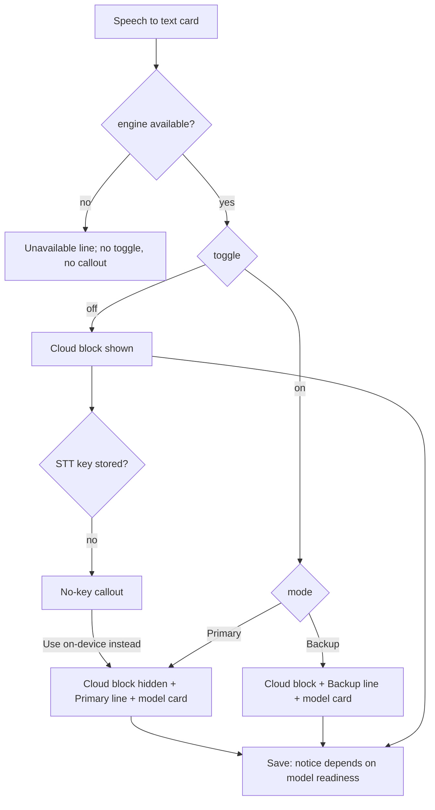

# Spec: Choosing a transcription setup

- **Intent:** ./intent.md
- **Plan:** ../../tasks/new-users-cannot-choose-a-transcription-setup-plan.md
- **Status:** Draft for product-owner review
- **Written:** 2026-10-29. UI design delegated to Claude by the product owner.

## 1. Overview

**Feature.** New users get one place to choose cloud or on-device transcription, with plain tips
where they make each choice.

**Phase.** Polish: it reworks existing Settings and first-run surfaces. It adds no engine, provider or
config field.

**Two tracks, shipped apart:**

| Track | What | Ships |
|---|---|---|
| A. Settings and first run | On-device moves into the Speech to text card; tips, key links, provider lines | In the next Minor release |
| B. On-device model check | A side-by-side test of Parakeet v3 against two English-only builds | A results report only. Any model switch is a separate release, and only after the product owner approves the evidence |

**Dependencies.** None blocking. The wizard-theme intent (`intent/the-wizard-theme-feels-half-finished/`)
is changing `theme.rs` and may restyle first run at the same time. See §8b.

## 2. Design (Track A)

### 2.1 Decision: one card, cloud first, on-device as a toggle

The Settings "On-device" section goes away. The Speech to text card in **Settings → Dictation** holds
the whole decision. The cloud controls come first because the cloud stays the default path. The
on-device toggle sits at the bottom of the card. When on-device is Primary, the cloud controls hide,
so the toggle is then the first thing in the card.

The three existing modes map one to one, with no config change:

| UI state | `LocalMode` (`crates/hark-config/src/local.rs:12-23`) |
|---|---|
| Toggle off | `Off` (default) |
| Toggle on, **Backup** | `Fallback` |
| Toggle on, **Primary** | `Primary` |

Turning the toggle on picks **Backup** when a cloud key is stored and **Primary** when none is.
Mode changes apply on Save, like every other field. The model download still starts only from its own
button and never from the toggle.

**Rejected alternative.** A two-way "Cloud | On this computer" switch at the top of the card. It
gives on-device the same weight as the cloud default, and it drops the product owner's own words
("a toggle, with a choice between Primary and Backup").

### 2.2 Wireframes

Cloud (Off), no key stored. This is the first-run and "I have nothing yet" state:

```
Speech to text
(•) Deepgram  ( ) OpenAI  ( ) Groq  ( ) Gemini  ( ) OpenAI-compatible
Hark's default. A speech-to-text service built for dictation. Uses nova-3 unless you change it below.
[key] No key for deepgram yet · Get a Deepgram key
[ Paste API key ................ ] [Store]
┌───────────────────────────────────────────────────────────────────────┐
│ [waveform] No paid AI key? Use on-device.                             │
│ Free and offline after a one-time 670 MB download.                    │
│ [Use on-device instead]                                               │
└───────────────────────────────────────────────────────────────────────┘
[Test connection] ...
▸ Model and endpoint (optional)
────────────
[ ] Use on-device transcription
    Runs on this computer, so audio never leaves it. One-time 670 MB download.
```

Primary:

```
Speech to text
[x] Use on-device transcription
    (•) Primary: offline, no key needed
    ( ) Backup: when the cloud fails or is slow
    Audio stays on this computer. Live meeting transcripts run here too.
    ┌ Parakeet TDT 0.6B v3 (int8) · 670 MB ───────────────┐
    │ [check] Downloaded and ready.   [Re-download] [Delete] │
    │ Model weights: CC-BY-4.0 — NVIDIA                      │
    └────────────────────────────────────────────────────────┘
Cloud speech-to-text is off. Choose Backup to use a cloud provider first.
```

Backup: the full cloud block shows as in the first wireframe (the callout is hidden once a key is
stored). The toggle block below it has **Backup** selected, the line "Audio goes to your cloud
provider first. If it fails or takes longer than 6 s, Hark transcribes the clip on this computer.",
and the model card. The "6 s" comes from `local_stt.fallback_after_ms` and is never hard-coded.

### 2.3 Requirements

**Section and layout**

- R1. Remove `Section::OnDevice` from the enum, `ALL`, `label`, `icon` and the dispatch
  (`ui/settings/sections.rs:11-61`, `:125-127`). Nothing else uses it; an explorer checked every
  reference. Nothing persists `Section`, so no migration is needed.
- R2. The Speech to text card renders in this order: the cloud block, then the on-device block. In
  Primary, a one-line note replaces the cloud block: "Cloud speech-to-text is off. Choose Backup to
  use a cloud provider first."
- R3. The cloud block contains the provider radios, the selected provider's line, the key section with
  its link, the no-key callout, Test connection, and Model and endpoint. In Primary it is hidden
  completely, including the Test box (`test.rs`), which only tests the cloud.

**On-device block** (built from `local.rs` minus the old `section`)

- R4. When the engine is available (`LocalEngine::is_available()`), show the checkbox **Use
  on-device transcription** with the line "Runs on this computer, so audio never leaves it. One-time
  {size} download." Get the size from `format_bytes(spec.total_bytes())`, never a literal.
- R5. When the engine is unavailable, show the existing "This build of Hark does not include the
  on-device engine…" line (`local.rs:57-69`) in place of the checkbox.
- R6. When the toggle is on, show the radios **Primary: offline, no key needed** and **Backup: when
  the cloud fails or is slow**, then a visible line explaining the selected option (privacy copy,
  §2.4), then `local::card` directly below. The line must be visible text, not only hover text.
- R7. Toggle on means `mode = Backup` if the STT key is stored, otherwise `Primary`. Toggle off
  means `Off`. Any mode change calls `download.refresh_status()`, as `local.rs:45-47` already does.
- R8. When the toggle is off and a download is still running, show one line with the progress and a
  **Cancel** button. A hidden 670 MB transfer is a silent behavior. The old UI had this gap too.

**Tips at the point of decision**

- R9. **No-key callout.** Show it only when all three hold: the engine is available, the STT key
  status is not `Stored` (that is, `Missing` or `Backend`), and the mode is not Primary. It is a
  `theme::tip` containing "No paid AI key? Use on-device. Free and offline after a one-time {size}
  download." and a normal (not primary) button **Use on-device instead**. The button sets `mode =
  Primary`. If the active voice would reuse the STT key for cleanup
  (`CleanupKeySource::ReuseSttKey`), it also sets `voice.default = Verbatim`, matching first run
  (`onboarding.rs:155-157`). It does not start the download.
- R10. **Provider line.** Under the provider radios, show one line for the selected provider. Each
  radio also carries the same line as hover text. The copy is in §2.5. The line names the default
  model from `Provider::resolved_model()`, never a literal.
- R11. **Get a key link.** Put it on the key status row, but only while the status is not `Stored`.
  Use `ui.hyperlink_to` so it can take keyboard focus and shows the URL on hover. OpenAI-compatible
  gets no link. URLs are compile-time `https://` constants with no query string.
- R12. **Model header.** Rename "Model & endpoint" (`form.rs:145`) to **Model and endpoint
  (optional)**, or to **Model and endpoint (required)** for OpenAI-compatible. Give the header an
  explicit `id_salt`, because egui derives a `CollapsingHeader` id from its label, so a label that
  changes would lose the open state. Inside, add one weak line: "Leave blank to use the recommended
  model." Keep the one-shot auto-open for custom endpoints exactly as it is (LL-G
  `egui-collapsingheader-controlled-open-latch`).
- R13. **`theme::tip` helper.** Use the existing `tint` fill, `CONTROL_RADIUS` corners, a new
  `TIP_PADDING` spacing token, and a leading icon plus text, so the tip is never color alone. `tint`
  is already covered as a text background in
  `theme/tests.rs:34-58`, across all palettes. Add a test that pins the tip fill to `tint`, so changing
  the fill forces a fresh contrast check.

**Keys in Primary**

- R14. In Primary, a non-Verbatim voice whose cleanup reuses the STT key must still show that key's
  status and a way to store it, because the STT key box above is hidden. The Cleanup provider section
  (`cleanup.rs:93-110`) shows a `KeySection` for the STT account in that case.

**Save and honesty**

- R15. **Save notice.** If the saved mode is Primary and the model is not ready, the notice reads
  "Saved. Dictation works once the on-device model finishes downloading." It must not read "Saved.
  Dictation is ready." (`mod.rs:247-251`).
- R16. **Privacy line.** The line under the Dictation section (`sections.rs:187`) depends on the
  mode. The copy is in §2.4.

**First run** (`onboarding.rs`, `get_started.rs`)

- R17. The engine-choice step shows a `theme::tip`: "No paid AI key? Choose on-device. You can add a
  cloud provider later in Settings." The on-device option's detail line includes the download size.
- R18. Readiness and the Configure view follow `draft.local_stt.mode == Primary`, not the
  `GetStarted.local` flag. Remove the flag. A user who clicks the callout or turns the toggle to
  Primary during Configure sees the on-device setup and the "Finish downloading the model to
  continue." gate. Backup still requires a passed cloud test.

### 2.4 Copy: modes and privacy

| Where | Off | Backup | Primary |
|---|---|---|---|
| Line under the selected radio | — | Audio goes to your cloud provider first. If it fails or takes longer than {n} s, Hark transcribes the clip on this computer. | Audio stays on this computer. Live meeting transcripts run here too. |
| Section footer (R16) | Cloud transcription sends audio to your chosen provider. Non-Verbatim voices may also send text to your cleanup provider. (unchanged) | Audio goes to your cloud provider first; the on-device backup runs on this computer. Non-Verbatim voices may also send text to your cleanup provider. | On-device transcription keeps audio on this computer. Non-Verbatim voices may still send text to your cleanup provider. |

The Primary hover text adds: "Meeting final passes and notes have their own settings and can still
use cloud providers." This matches the README's Privacy section.

### 2.5 Copy: providers (verified 2026-10-29)

| Provider | Line (R10) | Get a key (R11) |
|---|---|---|
| Deepgram | Hark's default. A speech-to-text service built for dictation. Uses {model} unless you change it below. | `https://console.deepgram.com` |
| OpenAI | Accurate general-purpose transcription. Uses {model} unless you change it below. | `https://platform.openai.com/api-keys` |
| Groq | Very fast Whisper. Each request is billed as at least 10 seconds, so short clips cost more than they sound. | `https://console.groq.com/keys` |
| Gemini | Streams while you hold the key. Smart mode can tidy text in the same call. On Google's free tier, Google may use what you send to improve its products. | `https://aistudio.google.com/apikey` |
| OpenAI-compatible | Any server with an OpenAI-style transcription endpoint, including one you run. Enter its URL and model below. | none |

Sources:
- Deepgram docs: create-additional-api-keys.
- OpenAI speech-to-text guide.
- Groq rate-limits doc. The 10 s minimum is in `CLAUDE.md`.
- Google AI Studio API-key doc and Gemini pricing page, for the free-tier data use.

The OpenAI key URL was not loaded directly; re-check it before shipping.

**No prices and no free-tier claims for cloud providers.** They change without a Hark release, and
Hark cannot detect the change. The free path Hark advertises is on-device. Gemini's free-tier
data-use line is the one exception, because it is privacy disclosure, not marketing. Code keeps the
table in one place, with a "verified on" date.

### 2.6 Data flow



State lives in the existing `SettingsPage` draft and caches: `stt_keys` caches the key status, and
`download` is polled every frame from `mod.rs:130-134`. Nothing new runs per frame. No keychain read
happens per frame.

### 2.7 Files

| File | Change |
|---|---|
| `ui/settings/sections.rs` | Remove `OnDevice`; `dictation_section` calls the new card; mode-aware privacy line |
| `ui/settings/stt_card.rs` (new) | `impl SettingsPage` Speech to text card, on-device block, callout, pure decision functions |
| `ui/settings/provider_help.rs` (new) | Provider copy and key-URL table, plus lookup |
| `ui/settings/local.rs` | Drop `section`; keep `card`, `unavailable`, controls |
| `ui/settings/keys.rs` | Optional key-page link on the status row |
| `ui/settings/form.rs` | Header rename and `id_salt`; provider-line hover; "leave blank" line |
| `ui/settings/cleanup.rs` | R14 key section in Primary |
| `ui/settings/mod.rs` | R15 save notice |
| `ui/settings/onboarding.rs`, `get_started.rs` | R17, R18 |
| `theme.rs`, `theme/tests.rs` | `tip`, `TIP_PADDING`, fill test |
| `crates/hark-local-stt/src/model.rs:113` | Fix the stale "Latest revision" comment |
| `README.md`, `Docs/features/DESKTOP_UI.md`, `Docs/features/ON_DEVICE_STT.md` | "Settings → On-device" becomes "Settings → Dictation → Speech to text" |

`form.rs` is already 531 lines, so new UI goes in the two new modules, not there. Every UI module
stays at or under about 300 lines.

## 3. Design (Track B): on-device model check

The intent decides: keep Parakeet TDT 0.6B v3 int8 unless a side-by-side test on real dictation
shows a clear gain. The model changes only with a Hark release.

**Candidates.** All three run with Hark's existing sherpa-onnx `nemo_transducer` config
(`engine.rs:68-98`, same four file names) and are about 640-670 MB each.

| Model | Languages | Licence | Released | Published avg WER |
|---|---|---|---|---|
| `parakeet-tdt-0.6b-v3-int8` (current) | 25 European | CC-BY-4.0 | 2025-08 | 6.32 |
| `parakeet-tdt-0.6b-v2-int8` | English | CC-BY-4.0 | 2025-05 | 6.05 |
| `parakeet-unified-en-0.6b-int8` (non-streaming) | English | **NVIDIA Open Model License** | 2026-04 | 5.91 |

The published averages are from read and broadcast benchmarks, not push-to-talk dictation, and the
gaps are small and mixed per dataset. That is why the real-clip test exists.

**Corpus.** Dictation history keeps no audio (`hark-store/migrations/001_init.sql`), so the product
owner records clips:
- At least 60 clips and 1,200 reference words, recorded on their usual mic and in their usual room.
- Real dictation content: messages, prompts, notes, names, numbers and Spellbook terms.
- A mix of short (under 3 s), normal and long (30 s and over) clips.
- References are what was meant, typed by the product owner. They may start from an independent
  cloud transcript, never from either test arm, to avoid anchoring.
- Clips and references stay out of the repo.

**Metrics.** Measured per model, on the same machine and sherpa-onnx version, at `threads = 2`:
- Normalized WER (case-folded, punctuation stripped).
- Formatted error rate (punctuation and case kept, because Verbatim injects the text as-is).
- Recall of Spellbook terms and proper nouns.
- Median decode time per clip, and load time.

**"Clear gain" threshold (proposed; the product owner sees the evidence).** Switch only if a
candidate meets **all** of these. Otherwise keep v3.

1. Normalized WER is at least **15% lower relative** to v3, **and** the 95% paired bootstrap
   interval (over clips) for the difference excludes zero.
2. The formatted error rate is no more than 0.5 points worse.
3. Spellbook and proper-noun recall is no lower than v3.
4. Median decode time is at most 110% of v3, and load time at most 120%.
5. The licence and English-only scope are acceptable to the product owner (§8, Q1).

A small corpus widens the interval and so favors keeping v3. That matches the owner's rule: "not
much difference means keep v3".

**Output.** A results report with aggregate numbers only, the ten clips with the largest per-clip
difference in each direction (shown to the owner locally, not committed), and a recommendation. The
owner's decision goes into the intent's Decisions section.

**If a switch is approved,** it is its own release with its own plan. That plan adds a new
`ModelSpec` with pinned checksums, keeps v3 in `CATALOG` so existing configs still resolve, and
decides how existing users move over. Nothing switches automatically, because the model never
updates itself.

## 4. Data model

No change. `LocalMode` values, `config.toml` keys and the history schema stay the same.

## 5. API contract

None. The only outbound effect is the user clicking a constant `https://` link, which opens the
system browser.

## 6. Acceptance criteria

Track A:

- AC1. Settings navigation has no On-device entry. `Section::ALL` has 7 entries.
- AC2. With the engine available, the Speech to text card shows the toggle. Without it, the card
  shows the unavailable line and no callout.
- AC3. Turning the toggle on gives Backup when a key is stored and Primary when none is. Turning it
  off gives Off.
- AC4. In Primary, these are all absent: provider radios, provider line, key section, Test
  connection, and Model and endpoint. The "Cloud speech-to-text is off" note is present.
- AC5. The callout shows if and only if the engine is available, the key is not stored and the mode
  is not Primary. Its button sets Primary, sets Verbatim only when cleanup reuses the STT key, and
  starts no download.
- AC6. Every provider except OpenAI-compatible has a line and an `https://` key URL with no query
  string. The selected provider's line is visible. The link shows only while no key is stored.
- AC7. The model header reads "(optional)", or "(required)" for OpenAI-compatible. It auto-opens
  once for OpenAI-compatible and can be collapsed afterward. Its id survives the label change.
- AC8. The privacy line and the selected-mode line match §2.4 for each mode.
- AC9. Saving Primary without a ready model shows the downloading notice, not "Dictation is ready".
- AC10. In Primary with a cleanup voice that reuses the STT key, the Cleanup provider section shows
  that key's status and a Store field.
- AC11. In first run, the engine choice shows the tip. In Configure, choosing Primary by toggle or
  callout switches to the on-device view and gates on the model download. Backup gates on a passed
  test.
- AC12. With the toggle off during a download, a progress line with Cancel is visible.
- AC13. `theme::tip` fills with `tint` and always draws an icon with text. The tests pin the fill.
- AC14. On real Windows, every new control can be reached by Tab and operated by keyboard, and the
  link opens the browser with no console flash. macOS is next. Linux must compile.
- AC15. No UI module exceeds about 300 lines. `fmt`, strict `clippy`, tests, `npm run check:claude`
  and `npm run check:docs` pass, recorded per toolchain (§8).

Track B:

- AC16. A results report exists with the §3 metrics for v3 and each candidate, measured with
  sherpa-onnx at Hark's pinned version, and states the threshold verdict per criterion.
- AC17. The product owner's keep-or-switch decision is recorded in `intent.md`. No model changes in
  this work.
- AC18. The stale "Latest revision" comment at `model.rs:113` is corrected.

## 7. Out of scope

- The model updating itself (intent decision).
- Implementing a model switch. That needs a separate plan after approved evidence.
- Prices or free-tier claims for cloud providers.
- A model picker or catalog of cloud models. The free-text field stays, defaulting to the
  recommended model.
- Footer copy, tray menu, Meetings settings, and the cleanup provider's own key links.
- The colour pass and parchment work (wizard-theme intent).
- Live key validation on paste. Test connection already covers it.

## 8. Assumptions and open questions

**Product owner decision (2026-10-29, "Use your picks"):** **Skip Track B in this round.** Keep Parakeet v3, and download or evaluate no candidate model. Q1 and the clip-corpus ask are moot. Do still fix the stale "Latest revision" comment in `model.rs`.

**Question for the product owner (blocks only the Track B verdict):**

- **Q1.** Both candidates are English-only, and the strongest one, `parakeet-unified-en`, uses the
  NVIDIA Open Model License rather than CC-BY-4.0. Is an English-only model acceptable in principle,
  and is that licence acceptable? If either answer is no, the matching candidate drops out before
  any download. Default if unanswered: test both and report. A switch still needs your yes.

**Ask of the product owner (Track B):** record the clip corpus in §3. Estimate: about 45 minutes to
record 60 clips, plus about 30 minutes to correct the references.

**Assumptions (engineer defaults; overturn any of them in review):**

- A1. No cloud prices or free-tier claims (§2.5).
- A2. Toggle-on default depends on whether a key is stored (R7). The callout button is a normal
  button, not the accent primary button, so on-device is not promoted over the default.
- A3. The Get a key link hides once a key is stored. Rotating a key is rare, and the link would be
  noise.
- A4. Track B decodes with the sherpa-onnx Python wheel pinned to Hark's library version, run on
  Windows. That avoids this machine's GNU link failure (LL-G
  `sherpa-onnx-windows-gnu-no-static-lib`). Rust-side tests run with `--no-default-features` here.
  CI's MSVC and Linux runners cover default features.
- A5. `HARK_STT_KEY` env-var users see the no-key callout even though dictation works. That is an
  existing quirk of the key status line, and only developers hit it.
- A6. The 15% relative threshold and the 60-clip, 1,200-word floor are engineering proposals. The
  intent leaves "clear gain" to the engineer, with the evidence shown to the owner.

**Carried from the intent:** "What counts as a clear enough gain?" This is answered in §3, pending
the owner's view of the evidence.

## 8b. Flagged concerns

| Policy | Conflict | Who resolves |
|---|---|---|
| `design-guardrails.md` §5 (honest privacy) and `REVIEW.md` §2 (silent failure) | Provider key URLs and Gemini's free-tier data-use line can go stale without a Hark release, and nothing would fail. Mitigation: one table, a "verified on" date, and a re-check item in the plan's Ship checklist. Some residual risk remains. | Release owner, at each release |
| `crates/hark-app/CLAUDE.md` (tokens in `theme.rs`) | The wizard-theme work is editing `theme.rs` and may add a Parchment palette. `tip` reuses `tint`, so a new palette is covered only if it is added to `palettes()` in `theme/tests.rs`. | Engineer implementing either intent; coordinate before editing `theme.rs` |

## 10. Error handling

| Failure | Behaviour | User sees |
|---|---|---|
| Keychain backend error | Status `Backend`; callout shows (on-device needs no key) | Existing "Keychain unavailable: …" line plus callout |
| Engine not in this build | No toggle, no callout | "This build of Hark does not include the on-device engine…" |
| Model download fails or is cancelled | Existing `Phase::Failed` / `Cancelled` lines | Icon + message in the model card; Resume resumes |
| Primary saved before the model is ready | Pipeline starts; each dictation fails until the download finishes | R15 notice; existing warning in the card (`local.rs:191-203`) |
| Browser fails to open the key link | egui hands the URL to the OS; no in-app error | The hover shows the full URL, so it can be typed |
| Save fails | Existing sticky bar error | Unchanged |
| Toggle off during a download | Download continues | R8 progress line with Cancel |

## 11. Rollback

Revert the Track A commit. Config, history and keychain are untouched, and `Section` is not
persisted, so there is nothing to migrate back. Track B adds only a standalone tool and a report, so
reverting it touches no app code.
