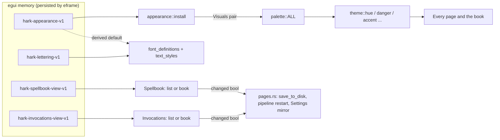

# Spec: The wizard theme goes all the way

- **Intent:** ./intent.md
- **Plan:** [../../tasks/the-wizard-theme-feels-half-finished-plan.md](../../tasks/the-wizard-theme-feels-half-finished-plan.md)
- **Status:** Implemented 2026-10-29 (Foundation, Core and Polish; released in 0.67.0 and 0.68.0). On-hardware review H1–H6 is still to run.
- **Written:** 2026-10-29
- **Size:** Medium to large. It touches the theme system, fonts and assets, two pages that gain a
  second renderer, and a color pass across every page.

## 1. Overview

Hark names its parts after spellcraft, but it looks like a settings tool. This spec adds four
things:

1. **Parchment**, a sixth theme. It is light only.
2. **Wizard lettering**, a switch independent of the theme. It changes headings and body text
   to a book face. Modern lettering (Inter) is the escape hatch.
3. **A book view** for the Spellbook and for Invocations. It is an optional toggle beside the
   existing list. You turn pages, entries are written out like a book, and you edit them in
   place.
4. **A color pass in every theme.** A per-theme set of six categorical hues, plus per-theme
   status colors, used at every level of the UI: navigation, page headers, sections, items and
   charts.

**Phases.** Foundation (tokens, palette, fonts), Core (lettering, book view), Polish (the color
pass on every page), Ship. The plan holds the order.

**Dependencies.**
- The meeting-speakers spec (`intent/meeting-speakers-are-hard-to-tell-apart/`) will consume
  the hue set in §3.3 for speaker colors. The hue set is one self-contained commit, so either
  feature can land it first. The contract is in the shared session notes
  (`wizard-theme-hue-tokens.md`).
- Font files need product-owner approval before download (§8, Q1). Without it, Wizard
  lettering is blocked. Parchment, the hues and the book view are not.

## 2. Decisions carried from the intent (not relitigated)

| Decision | Where it lands |
|---|---|
| Book view is optional; a toggle switches it with the list | §5.1 |
| Invocations get a book view in this round | §5.4 |
| Wizard lettering covers headings **and** body text, readable at body size | §4 |
| A separate switch offers a modern font on parchment colors | §4.2 |
| Entries are editable in the book itself | §5.3, §5.4 |
| No dark (candle-lit) Parchment | §3.1, Out of scope |
| More color on every page, in **all** themes | §6 |

## 3. Color system

### 3.1 Parchment palette

Parchment is a light palette of aged paper and iron-gall ink. Choosing it forces the egui
preference to Light, the same as choosing Light does today. The OS dark setting does not
change it, because no dark variant exists.

These are the starting values. The contrast tests in §9 are the gate: a value may move if the
tests or an on-hardware review say so, and the reason is recorded in a code comment, as
`SOLARIZED_LIGHT.text` already does.

| Role | Value | Note |
|---|---|---|
| `window` | `#f4ead5` | Must differ from Solarized Light `#fdf6e3`; `palette()` reverse-looks-up by it |
| `surface` | `#fbf6ea` | Cards and book pages: lighter vellum |
| `sidebar` | `#eadcbf` | |
| `tint` | `#efe2c6` | Hero and banner ground |
| `hairline` / `hairline_strong` | `#dccdae` / `#a38f6b` | |
| `fill_hover` | `#f0e5cc` | |
| `text` / `text_strong` / `text_weak` | `#3d3024` / `#2b2119` / `#65533d` | Lowest is weak on sidebar, 5.42:1 |
| `accent` / `on_accent` | `#2e4c84` (lapis) / `#fbf6ea` | 6.24:1 lowest; button label 7.84:1 |
| `chart` / `chart_soft` | lapis `#2e4c84` / `#c9d2e2` | |
| `danger` / `success` / `warning` | `#a1301c` / `#2f6b3a` / `#82560c` | Lowest 4.71:1 |

Lapis is the accent, not rubric red, so the focus ring and links never read as an error. Red
goes to the hue set and the drop caps.

### 3.2 Status colors move into the palette

`danger`, `success` and `warning` become `Palette` fields. Today they are two constant pairs
chosen by `dark_mode`. The public functions `theme::danger(v)`, `success(v)` and `warning(v)`
keep their signatures, so no call site changes. Light, Dark and both Solarized themes keep
today's values. Only Parchment gets new ones. The `DANGER`, `SUCCESS` and `WARNING` constants
stay for the tray icon and the recording pill. Those are OS surfaces and do not follow the
theme (Out of scope).

### 3.3 Categorical hues: the "more color" seam

```rust
pub enum Hue { Blue, Teal, Green, Gold, Rose, Violet }   // Hue::ALL, 6 slots
pub fn hue(v: &Visuals, hue: Hue) -> Color32       // ink: text and icons
pub fn hue_wash(v: &Visuals, hue: Hue) -> Color32  // chip and badge fill
```

The contract for every palette:

- **`ink`** is at least **4.5:1** on `window`, `panel`, `surface`, `sidebar` and `tint`, so
  it is legal as text anywhere.
- **`ink` on `wash`** is at least **4.5:1**.
- The six inks in one palette are at least **0.06 apart in OKLab** (Euclidean), so speakers
  and series stay distinguishable.
- Hues are **categories, never states**. A hued element never carries a status glyph (CHECK,
  WARNING, X), and status colors are never used for categories. Some hue families overlap
  with status colors (gold and warning, green and success). That is tolerable only because
  of this rule and the icon-plus-label rule.

Starting values. Each passes every bullet above; computed 2026-10-29, lowest ratio shown.

| Palette | Blue | Teal | Green | Gold | Rose | Violet | Min OKLab gap |
|---|---|---|---|---|---|---|---|
| Light ink | `#2f5f9e` | `#1d6b6e` | `#3d6b26` | `#81580a` | `#a63a62` | `#6b4aa8` | 0.095 |
| Light wash | `#e3ecf8` | `#dcefee` | `#e2eed8` | `#f5ead2` | `#f8e3ea` | `#ece5f6` | |
| Dark ink | `#9cc2f2` | `#84d2ca` | `#b0d690` | `#e8c47c` | `#f2a8c2` | `#c9b4f4` | 0.067 |
| Dark wash | `#1f3048` | `#173a37` | `#24391c` | `#3d3115` | `#45202f` | `#30264a` | |
| Solarized Light ink | `#1d68a8` | `#15736c` | `#5a6800` | `#7d5c00` | `#a82a68` | `#5458a8` | 0.064 |
| Solarized Light wash | `#dde9ef` | `#d8ece5` | `#e6e9c8` | `#f1e5bf` | `#f5dde3` | `#e4e1ef` | |
| Solarized Dark ink | `#6cb4ef` | `#4cc4ba` | `#b3c34a` | `#e0b33a` | `#ef8fb8` | `#a9adf0` | 0.071 |
| Solarized Dark wash | `#0c3f5c` | `#07474a` | `#23472a` | `#3a3d1c` | `#3b2a45` | `#22305a` | |
| Parchment ink | `#2e4c84` | `#225f5a` | `#45602a` | `#7a5212` | `#96345a` | `#5e3a8c` | 0.074 |
| Parchment wash | `#e2e3e6` | `#d9e6dc` | `#e2e6cf` | `#f0dfba` | `#f1dcd8` | `#e6dbe6` | |

The Solarized inks are Solarized's own accent hues (blue, cyan, green, yellow, magenta,
violet), shifted in lightness to clear 4.5:1. They follow the precedent already set for
`base01`.

**Speaker colors.** The meeting-speakers spec owns the order, the "Me" rule and what happens
past six speakers. This spec reserves `theme::speaker_hue(slot: usize) -> Hue` as the single
place that mapping lives, and owns the values and tests above.

### 3.4 Palette identity

- `palette(v)` stops being an if-chain. It iterates `palette::ALL` (all five palettes) and
  matches on `window`. Unknown visuals still fall back to Light or Dark by `dark_mode`.
- Tests assert the window colors are unique, that `palette(&visuals(p))` returns `p` for every
  `p`, and that every `Appearance` installs palettes drawn from `ALL`. Without these, adding a
  palette to the array but not to the lookup would pass silently.

## 4. Lettering

### 4.1 Faces

| Role | Modern (today, unchanged) | Wizard |
|---|---|---|
| Body, Small (`Proportional`) | Inter Regular | **Alegreya** Regular |
| Buttons, subheadings (medium role) | Inter Medium | Alegreya Medium |
| Emphasis (semibold role) | Inter SemiBold | Alegreya SemiBold |
| Page titles, hero, brand, dialog titles, drop caps (serif role) | Lora (hero and brand); Inter Medium (titles) | **Cinzel Decorative** Regular, plus Bold for drop caps |
| Monospace: key names, timings, literal aliases | JetBrains Mono | JetBrains Mono, unchanged |
| Icons | Phosphor | Phosphor, unchanged |

Why these faces (all SIL OFL 1.1 on google/fonts, checked 2026-10-29):

- **Alegreya** is a calligraphic, humanist book face built for running text. Its x-height
  holds up at UI sizes. It is variable (`wght` 400-900), and egui 0.36 can pin instances
  through `FontTweak::coords`.
- **Cinzel Decorative** is a Roman inscriptional capital with swash forms. It is static, about
  60 KB per weight. It is legible for headings and caps-first by design, so it is never used
  for body text.
- **Rejected for body text:**
  - IM Fell English and DW Pica have deliberately rough scanned edges that turn to mush at 14
    px.
  - UnifrakturMaguntia is blackletter.
  - MedievalSharp is too stylized.
  - Cormorant has a hairline x-height.
- **Runner-up body face:** Spectral Regular. It is static, built for screens, and has less
  arcane flavor. It is used if the Foundation spike finds a problem with Alegreya's variable
  instances.

**Wizard type scale.** These are starting values; the spike fixes them, and a test pins them
like `type_scale_matches_the_spec`.

| Style | Size |
|---|---|
| Body | 15 |
| Small | 13 |
| Button | 14 |
| Subheading | 16 |
| Heading | 29, Cinzel Decorative |
| Monospace | 13 |

Alegreya reads smaller than Inter at the same size, so Body moves from 14 to 15. `CONTROL_HEIGHT`
(34) still fits.

### 4.2 The switch

- `pub enum Lettering { Modern, Wizard }` lives in `theme/lettering.rs`. It is persisted in
  egui memory under `hark-lettering-v1`, beside `hark-appearance-v1`.
- **Effective value.** An explicit choice always wins. With no saved choice, the value is
  *derived*: Wizard when the appearance is Parchment, Modern otherwise. So choosing Parchment
  gives the full wizard look, and the user can flip to modern fonts on parchment colors.
- **Every theme.** Once set, lettering is independent of the theme. Wizard on Dark is legal.
  This answers the intent's open question, provisionally (§8, Q2).
- **Where it lives.** A labeled checkbox, "Wizard lettering", under Settings → Appearance,
  beside the Theme picker. Its help text says it applies immediately and is remembered on this
  device. The top-bar appearance picker stays theme-only, because it has no room.
- **What switching does.** It calls `ctx.set_fonts(font_definitions(lettering))` and reapplies
  `text_styles(lettering)`. Fonts change on the next frame, and nothing is lost or reset. Both
  happen on the UI thread inside the existing `apply` and `set_*` paths.
- **Family roles.** The family keys are renamed from font names to role names: `"InterMedium"`
  becomes `"Medium"`, `"InterSemiBold"` becomes `"SemiBold"`, and `"Lora"` becomes `"Serif"`.
  A family named `InterMedium` that leads with Alegreya would mislead the next reader. The
  call sites (`medium()`, `semibold()`, `serif()`) do not change.
- **Fallback chain.**
  - Every text family stays `[lead, Phosphor, …egui defaults]`, so
    `every_family_resolves_and_leads_with_the_intended_font` still holds for both letterings.
  - The `Icon` family keeps leading with Phosphor, so the Inter private-use-area (PUA)
    collision guard is untouched.
  - Wizard adds Inter after Phosphor for coverage of arrows, ⌘ and similar symbols. Alegreya
    covers a–z, so Phosphor's lowercase glyphs are never reached; the coverage test enforces
    this.

## 5. Book view

### 5.1 The toggle

- **Control.** A two-option segmented control, `List | Book`, built from `theme::nav_button`
  with an icon and a label: LIST_BULLETS + "List", BOOK_OPEN + "Book".
- **Placement.** It sits right-aligned in a toolbar row under the page description, on both
  the Spellbook and Invocations pages. The selected option shows a fill, a highlight and
  `selected(true)`, so the selection is not shown by color alone. It has a focus ring.
- **Persistence.** Each page persists its own choice in egui memory:
  `hark-spellbook-view-v1` and `hark-invocations-view-v1`. The default is **List**, so nothing
  changes for anyone who never opens the book.
- **Add flow.** The page's add flow is not part of either view. That is the Spellbook's pinned
  add row and Undo row, and the Invocations "New invocation" button. It renders above the
  toggle's content and behaves identically in both views, including the History → Spellbook
  handoff (`prime_add`).

### 5.2 The book (shared by both pages)

- **Spread.** Two facing pages when the content column is at least `BOOK_SPREAD_MIN_WIDTH`
  (two `BOOK_PAGE_MIN_WIDTH` pages plus `BOOK_GUTTER`). One page when it is narrower.
- **Height.** The book fills the remaining page height, down to `BOOK_MIN_HEIGHT`. It is never
  inside a vertical page scroll.
- **Pages.** Pages are `surface`-filled, with a `hairline` edge and a gutter shadow
  (`book_gutter(v)`, a token beside `surface_shadow`).
- **Running head and folio.** Each page has a running head at the top: the page name, Small,
  weak. Each has a centered folio at the foot, "— 3 —", Small, weak.
- **Every theme.** The book draws only theme tokens, so it works in all six themes. It looks
  most like a book in Parchment with Wizard lettering.
- **Entries.**
  - Each entry opens with a **drop cap**: the first letter in the serif role at
    `DROP_CAP_SIZE`, in the page's hue (Spellbook Violet, Invocations Rose). The rest of the
    heading follows in the serif role.
  - Entries are separated by an ornamental rule: the existing fading rule with a small centered
    diamond painted on it.
- **Pagination.** Entries are packed onto pages in order, using their laid-out height.
  - An entry is never split across pages.
  - An entry taller than a page gets a page to itself, and that page's body scrolls internally.
    The page uses a `ScrollArea` with `id_salt("book-page-<n>")`, per LL-G
    `egui-scrollarea-shared-id-salt`.
  - The measurement uses the same galleys the painter draws, so what is measured is what is
    painted.
- **Anchor.** Position is stored as an **anchor entry index**, not a page number. Resizing,
  switching lettering, adding or deleting all reflow the pages, and the spread that shows the
  anchor stays open. The anchor is clamped when entries are deleted.
- **Page-turn controls.** A row under the book holds three controls:
  - `‹ Previous`: CARET_LEFT icon + label.
  - "Pages 3–4 of 12" (or "Page 3 of 12" with one page per spread), as text.
  - `Next ›`: label + CARET_RIGHT icon.

  At either end the button is disabled, not hidden. Both buttons get the focus ring.
- **Keyboard.**
  - PageDown and PageUp turn one spread; Home and End go to the first and last spread.
  - They apply only while no text field has focus (`!ctx.egui_wants_keyboard_input()`).
  - The book consumes them before any inner `ScrollArea` sees them.
  - The arrow keys stay with egui's own focus navigation.
  - Tab order runs from the page-turn row, through each entry's actions (left page, then
    right page), and back.
- **Motion.** A page turn is instant, with no animation. This satisfies the reduced-motion
  guardrail and keeps idle CPU at zero. A page-curl animation is Out of scope.
- **Empty book.** The opening page reads "This spellbook has no spells yet" (or "No
  invocations yet"), with the same call to action as the list's empty state.

### 5.3 Spellbook in the book

- **Entry.** Drop-capped term, then "Also heard as: a, b" (weak, aliases in monospace, as in
  the list), then an action row: PENCIL + "Edit", TRASH + "Delete".
- **Editing in place.** Edit turns the entry into its editor where it sits on the page. That
  means the term field and the alias editor. Both are the list's existing code, lifted out of
  the `entry_list` loop into methods both renderers call, so the semantics stay identical:
  - the term commits on lost focus or Enter;
  - Esc cancels;
  - aliases are added and removed through `edit.rs`;
  - at most one edit is open at a time.

  While an entry is open, the anchor is pinned to it, so the spread cannot turn out from under
  the cursor.
- **Adding.** After an add from the pinned row, the book opens to the spread that holds the new
  entry. A "New" chip (Violet wash, with the label as text) marks it for this session, matching
  `last_added`.
- **Saving.** Every change returns the page's existing `changed` bool. Save, pipeline restart
  and the Settings-draft mirror (`ui/pages.rs:199-212`) are untouched. The book adds no
  persistence path.

### 5.4 Invocations in the book

- **Entry.**
  - Drop-capped phrase, then a scope chip.
  - "Also: …" with the aliases.
  - The expansion **written out in full**, preserving line breaks, in body lettering.
  - The existing `skip_reason` warning, with WARNING icon + text in `warning`.
  - An Edit and Delete action row.
- **Editing in the book.**
  - Edit opens `editor::Draft` **across the whole spread**: the book lies flat and both pages
    become one writing surface, inside the book frame.
  - "New invocation" opens a blank `Draft` the same way.
  - The `Outcome` handling is the same function the list uses (`show_editor`'s match), so
    Save, Cancel and Delete behave identically. Saving is explicit, never on lost focus,
    because each commit restarts the pipeline.
  - Afterwards the book returns to the spread that shows the saved entry.
  - Page turning is disabled while a Draft is open, and the controls show as disabled.

## 6. The color pass (every page, every theme)

Each page gets a hue: Home Green, Insights Blue, History Gold, Meetings Teal, Spellbook
Violet, Invocations Rose. Settings uses `accent`. The mapping is `Page::hue()` in
`ui/pages.rs`, and the values live in `theme`.

Every hued element below already has, or gains, a text label or a glyph beside it.

| Level | Where | What changes |
|---|---|---|
| App chrome | Sidebar and narrow top bar (`ui/navigation.rs`) | Each nav icon in its page hue; the label stays text color; the selected state is unchanged (fill + highlight) |
| Page header | `ui/pages.rs` header block | Page icon in the page hue before the title; a short 2 px hue rule (`HEADER_RULE_WIDTH`) under the title |
| Home | `ui/home.rs` | Status icon tinted by state (success, accent or warning; icon + label already exist); serif headline keeps the accent |
| Insights | `ui/stats/panels.rs`, `charts.rs` | Each metric tile gains an icon in its own hue; voice and app breakdown bars use the hue set per series, with labels and legend text kept |
| History | `ui/history/row.rs` | Provider chip per row (Deepgram Teal, OpenAI Green, Groq Gold, Gemini Blue, On-device Violet) with the provider name as text; an "Invocation" chip in Rose where one fired |
| Meetings | `ui/pages.rs`, `ui/navigation.rs` only | Header and nav only, both drawn outside `ui/meetings/`, so no file under it changes; transcript speaker color belongs to the speakers spec |
| Spellbook (list) | `ui/spellbook/mod.rs` | Alias count as a Violet chip; entry count in the toolbar row |
| Invocations (list) | `ui/invocations/mod.rs` | LIGHTNING glyph in Rose before each phrase; scope as a chip |
| Settings | `ui/settings/sections.rs`, `keys.rs`, `local.rs` | Section-nav icons in a fixed per-section hue table; provider chips in Keys; an engine chip in On-device |

A new shared widget, `theme::chip(ui, hue, glyph: Option<&str>, text)`, draws a `hue_wash`
pill with an `ink` label and an optional icon (via `icon_text`). It is the only way a hue
reaches a chip.

**Not touched.** The footer, the update banner and every status line keep their status
colors. They are already correct, and recoloring them would blur state with category.

## 7. Architecture

### 7.1 Files

| File | Change |
|---|---|
| `theme.rs` | `Hue`, `hue`, `hue_wash`, `speaker_hue` (reserved), `chip`, book tokens (`BOOK_*`, `DROP_CAP_SIZE`, `HEADER_RULE_WIDTH`, `book_gutter`), `text_styles(lettering)`, status functions reading the palette |
| `theme/palette.rs` | `Palette` gains `danger`, `success`, `warning`, `hues`; adds `PARCHMENT`; `ALL`; table-driven `palette()` |
| `theme/hues.rs` **(new)** | The per-palette hue tables. It is a lookup table, so it is exempt from the ~500-line seam rule |
| `theme/appearance.rs` | `Appearance::Parchment`; `install` picks the pair from a per-variant table instead of the `solarized` bool |
| `theme/lettering.rs` **(new)** | `Lettering`, persistence, derived default, `lettering_toggle(ui)` |
| `theme/fonts.rs` | `font_definitions(lettering)`; role-named families |
| `theme/tests.rs` | Palette list from `palette::ALL`; new contrast, distinctness, lettering, coverage tests |
| `assets/` | Alegreya and Cinzel Decorative TTFs, `LICENSE-Alegreya.txt`, `LICENSE-CinzelDecorative.txt`, README rows |
| `ui/book.rs` + `ui/book/paginate.rs` **(new)** | Shared book frame, spread layout, page-turn row, keyboard, view toggle and persistence; the pure pagination function |
| `ui/spellbook/book.rs` **(new)** | Spellbook entry renderer for the book |
| `ui/spellbook/mod.rs` | Toggle; term edit lifted out of `entry_list` into a method both views call |
| `ui/invocations/book.rs` **(new)** | Invocation renderer; hosts `Draft` across the spread |
| `ui/invocations/mod.rs` | Toggle; outcome handling shared by both views |
| `ui/pages.rs`, `ui/navigation.rs` | `Page::hue()`, page-header icon and rule, nav tint |
| `ui/home.rs`, `ui/stats/*`, `ui/history/row.rs`, `ui/settings/{sections,keys,local,preferences}.rs` | Color pass (§6); lettering checkbox in `preferences.rs` |

### 7.2 Data flow



All of this runs on the UI thread. Nothing touches the dictation pipeline or the
release-to-inject path. A save that restarts the pipeline is the existing behavior.

### 7.3 State

- Each page's book state is `Book { anchor: usize }` plus the page's existing edit state. Both
  live in the page struct, so they reset on restart. Only the view choice persists.
- Theme, lettering and view preferences stay in egui memory, like the theme today. Nothing is
  added to `hark-config` or `config.toml`.

## 8. Assumptions and open questions

**Product owner decision (2026-10-29, "Use your picks"):** **Q1 approved.** Download the listed Alegreya and Cinzel Decorative files and their `OFL.txt` from `github.com/google/fonts` (`main`). The Spectral fallback is approved too, if the spike rejects Alegreya. Q2 was not put to the owner, so the engineer default stands.

**Questions for the product owner**

| # | Question | Default if unanswered |
|---|---|---|
| Q1 | **Approve downloading these font files** from `github.com/google/fonts` (`main`): `ofl/alegreya/Alegreya[wght].ttf` (~425 KB), `ofl/alegreya/OFL.txt`, `ofl/cinzeldecorative/CinzelDecorative-Regular.ttf` (~60 KB), `CinzelDecorative-Bold.ttf`, `ofl/cinzeldecorative/OFL.txt`. Fallback if the spike rejects Alegreya: `ofl/spectral/Spectral-Regular.ttf` plus `-Medium` and `-SemiBold`, and `OFL.txt`. | **Blocking for lettering.** Nothing is downloaded without a yes. Parchment, hues, the color pass and the book view proceed with Lora and Inter |
| Q2 | Intent's open question: can wizard lettering be used with other themes? | **Yes.** It is an independent switch. Until the user sets it, it follows the theme (Wizard on Parchment, Modern elsewhere); once set, it stays as set on every theme (§4.2) |

**Assumptions** (the implementer confirms before relying on them)

1. egui 0.36 (the workspace pin; `crates/hark-app/CLAUDE.md` still says 0.35) pins variable
   instances with `FontTweak::coords`, and 0.35 fixed glyph caching across variations. The
   spike proves this. If it fails, the fallback is static instances (Spectral, or static
   Alegreya if a pinned upstream release has them).
2. **Binary size.** It grows by about 0.55 MB (Alegreya plus two Cinzel weights), embedded even
   when Wizard is off. No stated budget forbids it. Lazy loading is Out of scope.
3. **Do not subset the fonts.** Cinzel Decorative declares the Reserved Font Name "Cinzel".
   Subsetting is a modification under OFL 1.1, and a modified font cannot keep that name.
   Ship the files unmodified.
4. Typical collections are tens of entries, and no cap exists. Pagination lays out every
   entry each frame, using egui's galley cache. This is fine into the hundreds. A
   measurement cache is added only with evidence (REVIEW.md: no hypothetical scale findings).
5. **Monospace is unchanged under Wizard.** It is used only for key names, timings and literal
   aliases (8 call sites), which are not body text.
6. The recording pill and tray icon stay out of the color pass. They are OS surfaces, always
   dark by design, and on the hot path.
7. The Phosphor codepoints for LIST_BULLETS, CARET_LEFT, CARET_RIGHT and PENCIL_SIMPLE come
   from the same egui-phosphor 0.12.0 package as the rest, read from its published source.
   They are never guessed. The embedded `Phosphor.ttf` already contains the glyphs.

## 9. Acceptance criteria

Each criterion maps to a test in the plan's Test Plan (T-numbers), or to the on-hardware
checklist (H) where egui cannot observe it headlessly.

**Themes**

- **AC1.** Parchment is selectable from both appearance pickers, survives restart, and
  installs Parchment visuals in both slots with the preference set to Light. Returning to
  System restores both neutral palettes. (T1, T2)
- **AC2.** For every palette in `palette::ALL`, every text role and every hue ink is at least
  4.5:1 on window, panel, surface, sidebar and tint. Ink on wash is at least 4.5:1, on_accent
  on accent is at least 4.5:1, and the focus ring is at least 3:1. (T3, T4)
- **AC3.** Within each palette, every pair of hue inks is at least 0.06 apart in OKLab. (T5)
- **AC4.** `palette(&visuals(p))` returns `p` for every palette, and the window colors are
  unique. (T6)

**Lettering**

- **AC5.** With no saved lettering, Parchment yields Wizard and every other theme yields
  Modern. An explicit choice survives restart and theme changes. (T7)
- **AC6.** In Wizard, every text family leads with its Wizard face and Phosphor sits second.
  The `Icon` family still leads with Phosphor, and the Modern definitions match today's
  exactly. (T8)
- **AC7.** The Wizard body and heading faces each contain every character in the coverage
  string: ASCII, Latin-1, `“”‘’–—…•·×`. (T9)
- **AC8.** No label overflows at widths 480, 860 and 1020 for every (appearance, lettering)
  pair. This extends the shell test in `ui/shell.rs`. (T10)

**Book view**

- **AC9.** List is the default on both pages. The book choice survives restart per page.
  Switching views never loses an in-progress edit. (T11)
- **AC10.** Pagination places every entry exactly once and in order. An entry taller than a
  page gets a page alone. After resize or delete, the spread still shows the anchor entry.
  (T12)
- **AC11.** PageDown, PageUp, Home and End turn spreads only when no text field has focus.
  The page-turn buttons are reachable by Tab and show a focus ring. (T13, H)
- **AC12.** A Spellbook entry edited in the book yields the same `entries` as the same edit in
  the list. The same holds for an invocation saved in the book. (T14)
- **AC13.** Adding from History while the Spellbook is in book view opens the spread with the
  new term. (T15)

**Color pass**

- **AC14.** Every page's nav icon and header icon render in that page's hue. Every chip has
  text, and no hue is paired with a status glyph. (T16, H)

**Release**

- **AC15.** `cargo fmt`, `cargo clippy --all-targets -- -D warnings`, `cargo test` and
  `npm run check:claude` all pass. `assets/README.md` lists each new font with its source,
  commit, download date and license file. (CI)

## 10. Error handling

| Failure mode | Behavior |
|---|---|
| A font file is missing at build time | `include_bytes!` fails the build; nothing fails at runtime |
| A font parses but lacks a glyph | Caught by T9 before release; at runtime egui falls back to the next font in the family |
| A variable instance does not pin (`coords` ignored) | Caught by the spike, which compares Medium and Regular advance widths. Fall back to static faces (§8, A1) |
| An unknown saved appearance, lettering or view key (downgrade or typo) | Keep the derived or default value, and never reset another preference. Mirrors `legacy_and_unknown_palette_preferences_keep_the_existing_choice` |
| A save fails after a book edit | The existing sticky notice on the page (`notice`), the same as the list. The book adds no path |
| The entry being edited is deleted elsewhere (Settings draft) | The existing index guards in the edit state apply. The anchor clamps to `entries.len() - 1` |
| The window is shorter than `BOOK_MIN_HEIGHT` | The book keeps its minimum height, and the page's outer area scrolls. Nothing clips silently |

User-facing text added by this spec:

- "Wizard lettering"
- "List"
- "Book"
- "Previous"
- "Next"
- "Pages N–M of K" / "Page N of K"
- "Also heard as"
- "This spellbook has no spells yet" / "No invocations yet"
- "New"

No error strings are added.

## 11. Out of scope

- A dark or candle-lit Parchment (decided 2026-10-29).
- Theming the recording pill and tray icon.
- Page-turn animation.
- Search inside the book.
- Printing or exporting the book.
- Lazy font loading or subsetting.
- Speaker colors in meeting transcripts. The speakers spec owns them; this spec only supplies
  the hues.
- Moving theme or lettering preferences into `config.toml`.

## 12. Flagged concerns

| Policy | Conflict | Who resolves |
|---|---|---|
| `design-guardrails.md` §3, "Respect OS light/dark" | Parchment is light only, so a user on a dark desktop who picks it gets a light window. This is the same trade as picking Light today, and it was accepted by the no-dark-variant decision. Recorded so it is visible, not reopened | Product owner (accepted 2026-10-29) |
| `design-guardrails.md` §1 and `hark-app/CLAUDE.md`, "UI modules under ~300 lines" | `spellbook/mod.rs` (406), `invocations/mod.rs` (385) and `invocations/editor.rs` (422) are already over. The book goes in sibling modules, and lifting out the term edit should shrink `spellbook/mod.rs`. This spec does not make them worse, but does not bring them under either | Engineer |
| `ux-laws.md` Jakob's Law | Paged reading of a settings collection is unconventional. This is mitigated by keeping List as the default and the book optional, per the intent | None (by design) |
